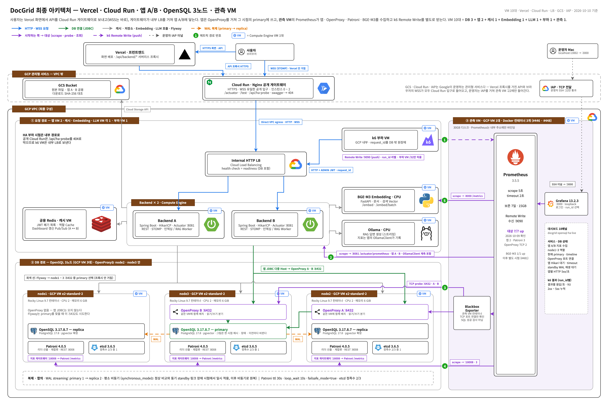

# DocGrid

[](https://github.com/DocGrid/docgrid/actions/workflows/ci.yml?query=branch%3Adevelop+event%3Apush)

> 팀의 지식에서 권한을 지키며 근거가 포함된 답을 찾는 오픈소스 문서 검색 워크스페이스

DocGrid는 PDF·DOCX·HWP 5.x·HWPX·TXT·Markdown(MD) 문서를 저장·인덱싱하고, 현재 열람할 수 있는
문서를 검색과 RAG 답변에 활용합니다. 문서·컬렉션·권한·인용 근거와 작업 복구를 웹에서 관리합니다.
로컬 실행은 PostgreSQL·Valkey·Local Filesystem을 사용하며, GCP에서는 OpenProxy를 통한 OpenSQL 3노드와
GCS 경로를 시험했습니다. 배포 구성과 각 시험의 적용 범위는 아래에서 구분합니다.

[검증된 범위](#검증된-범위) · [아키텍처](#아키텍처) · [빠른 실행](#빠른-실행) · [환경 선택](#환경-선택) · [테스트](#테스트)


## 시연 영상

썸네일을 누르면 YouTube에서 재생됩니다.

| 1. 서비스 사용 흐름·인덱싱 장애 대응 | 2. OpenProxy A 장애 중 k6 부하·HTTP 응답 |
|---|---|
| [](https://youtu.be/t2JHrvTSC-w) | [](https://youtu.be/hwP4-J86BqE) |
| **3. OpenProxy A 장애 중 실제 웹 기능** | **4. Primary VM 장애·Failover·멱등 재전송** |
| [](https://youtu.be/i9-LmozKqu4) | [](https://youtu.be/NWlwwDB0a94) |


## 주요 기능

- **문서 인덱싱:** 원본 Parsing·Chunk 분할·BGE-M3 Batch Embedding·pgvector 저장을 Worker가 처리합니다.
  HWP/HWPX는 본문·표 셀 텍스트, Markdown은 Heading 구조를 추출합니다. HWP 3.x·암호 문서·이미지 OCR은 지원하지 않습니다.
- **현재 권한 기반 검색·답변:** 사용자·역할·부서와 공개 범위를 확인합니다. 저장 답변·대화 조회 및 모델 입력 준비 시
  이전 대화를 포함한 문서 출처를 현재 Primary 권한으로 재검증합니다. [권한 시험](docs/test-results/permission-current-auth-20261019/README.md)
- **근거와 작업 복구:** Ollama 답변과 Chunk 인용을 저장합니다. 다중 백엔드의 RAG 작업은 token·lease로 소유권을
  관리하며, 재선점 뒤 이전 작업자의 늦은 결과 확정을 차단합니다.
- **지식 워크스페이스:** 문서 Version·형식별 미리보기·원본 다운로드·계층형 컬렉션·직접 권한 부여와 회수를 제공합니다.
- **MCP 연동:** 전용 Access Token으로 검색·문서 상세·인덱싱 상태 도구를 제공하고 Rate Limit·출력 Sanitization을 적용합니다.
- **운영·정합성 점검:** WebSocket 대시보드, Retry·Queue 관측과 원장·Job·Chunk·Vector의 8종 점검을 제공합니다.
  관리자가 수동 실행하며, Job·Vector 누락의 안전 복구를 지원합니다. 주기 점검은 기본으로 꺼져 있습니다.
- **저장소·DB 연결:** 로컬 파일·GCS Adapter와 OpenProxy A/B·OpenSQL 연결을 지원합니다. MinIO·S3는 선택형 Adapter입니다.

## 검증된 범위

수치는 실행별 관측값입니다. 환경·부하·리비전이 다른 회차를 합산하지 않으며, 각 기록에 준비 문제·재시도·실패·정리를 보존했습니다.

### 대표 결과

| 목적 | 검증 분야 | 환경·조건 | 관측 결과와 한계 | 증거 | 관련 PR |
|---|---|---|---|---|---|
| **OpenSQL 장애 중 성공 응답 보존** | 고가용성(HA)·데이터 내구성 | GCP 3노드, 네트워크 분할 회차별 최초 요청 751건 | 비동기: 최초 201 632건 중 40건 유실. 별도 동기 strict 회차: 201 586건 누락 0, HTTP 오류·결과 불명 발생. 동기는 시험용 역할 어댑터 경유 | [비동기](docs/test-results/opensql-primary-network-partition-20261017/README.md) · [strict](docs/test-results/opensql-primary-network-partition-sync-20261017/README.md) | [#548](https://github.com/DocGrid/docgrid/pull/548) |
| **DB·GCS 외부 복원** | 백업·복구(DR) | 실제 OpenSQL·Barman·GCS, 전용 논리 DB·별도 PGDATA(물리 호스트 공유), 2026-10-18 | 성공 응답 65건 중 60건 복원·5건 손실. 마지막 외부 보존 확인 구간 60건 누락 0. 공개 트래픽 전환·Ollama 제외 | [WAL 완료 경계 수정](docs/test-results/wal-offsite-boundary-20261018/README.md) · [재계측](docs/test-results/wal-offsite-recovery-recheck-20261018/README.md) | [#564](https://github.com/DocGrid/docgrid/pull/564) · [#565](https://github.com/DocGrid/docgrid/pull/565) |
| **RAG 작업 소유권·현재 권한** | 작업 정합성·접근 제어 | 로컬 격리 PostgreSQL·실제 Backend, 제어 모델 서버. 소유권은 JVM 2대, 권한은 별도 실제 인증 HTTP 시험 | 소유권 총 7회: 통과 4회·준비/시험 데이터 오류 2회·불합격 1회(원인 미확정). 통과 회차에서 B 기동 시 호출 1회, A 중단·재선점 시 호출 2회·최종 답변/인용 단일 확정. 별도 권한 HTTP 9/9 통과. 실제 Ollama 제외, 이 시험에서 공개 배포 미실행 | [소유권](docs/test-results/rag-ab-ownership-20261016/README.md) · [권한](docs/test-results/permission-current-auth-20261019/README.md) | [#513](https://github.com/DocGrid/docgrid/pull/513) · [#515](https://github.com/DocGrid/docgrid/pull/515) · [#516](https://github.com/DocGrid/docgrid/pull/516) · [#567](https://github.com/DocGrid/docgrid/pull/567) |
| **Generic Plan 검색 지연 개선 · 로컬** | 검색 성능·쿼리 최적화 | 로컬 PostgreSQL 17.8, 약 5만 청크(합성 92.9%)·허용 100%·topK 10·질문 30개, `plan_cache_mode=force_generic_plan` 고정·수정 전후 연속 측정 | 벡터 검색 단계 p50 4,465.7→218.5ms, 하이브리드 5,799.9→1,380.6ms. 전체 REST API·OpenSQL 경로의 지연이 아님 | [측정·조건](docs/test-results/gimin-%23549-generic-plan-query-vector-cast.md) | [#550](https://github.com/DocGrid/docgrid/pull/550) |
| **Generic Plan 자연 전환·수정 효과 · OpenSQL/JDBC** | 검색 성능·제품 경로 검증 | 실제 OpenSQL 17.8·원본 OpenProxy 별도 리스너 2개·pgJDBC 42.7.11, 50,008청크(합성 92.9%)·D01 1개·허용 100%·SQL 후보 40·`auto` | Generic p50: A 9,755.10→977.76ms, B 9,880.39→1,016.81ms(각 SQL Generic n=16). 최종 결과 120/120 일치. JDBC 왕복이며 공개 HTTP·Spring/Hikari·하이브리드 미측정 | [회차·계획·제외·정리](docs/test-results/opensql-jdbc-generic-plan-20261021/README.md) | [#550](https://github.com/DocGrid/docgrid/pull/550) · [#568](https://github.com/DocGrid/docgrid/pull/568) |

RAG 소유권 7회는 서로 다른 준비·장애·경합 시나리오이며 서비스 성공률이 아닙니다.
로컬 Generic Plan 대표 수치는 강제 조건입니다. 별도 OpenSQL·JDBC 시험은 `auto`에서 서버 준비문별 자연 전환을 확인했습니다.
이번 JDBC 값은 IAP·SSH·Proxy 왕복을 포함하며, 공개 HTTP·Spring/Hikari 응답시간이나 하이브리드 검색 측정값이 아닙니다.

네트워크 분할의 별도 멱등 API 회차에서는 새 요청 751건의 최초 201 585건을 보존했습니다.
복구 뒤 같은 ID 재전송은 기존 585건을 200, 미반영 166건을 201로 처리해 최종 751건·중복 0건이 됐습니다.
최초 요청 가용성과 재전송 뒤 수렴을 구분합니다. [최초 원장·재전송](docs/test-results/opensql-primary-network-partition-retry-20261017/README.md)

### 복구 계측과 손실 경계

10월 15일 시험은 지정 시점 T 이전 쓰기 A 1건·이후 B 0건과 GCS 사본 해시 92/92 일치를 확인했으며 RPO·RTO는 미측정입니다.
[시점 복원](docs/test-results/db-gcs-point-in-time-recovery-20261015/) · [후속 서비스 시험](docs/test-results/db-gcs-service-recovery-20261015/)

10월 18일 최초 계측은 65건 중 33건 복원·32건 손실이었습니다. 필요한 WAL의 완료 확인을 보완한 재시험은 위 표와 같습니다.
최초 감사 때 Worker·Flyway·수선을 끈 상태로 원장·DB·원본을 대조한 뒤 활성화했습니다.
마지막 외부 보존 확인 뒤의 5건은 DB와 원본 모두 보존 범위 밖이었습니다.
마지막 연속 복원 성공 응답부터 T0까지의 관측 간격은 113.978초이며 운영 RPO 보장값이 아닙니다.

| 사용자 기능 | T0부터 완료까지 | 표본 |
|---|---|---|
| 기존 원본 다운로드·해시 | 162.9초 | 4건 |
| 기존 문서 검색 | 178.447초 | 1건 |
| 중단 Job 재개 | 234.365초 | 1건 |
| 새 업로드 | 241.423초 | 1건 |
| 새 문서 인덱싱 | 910.719초 | 1건 |
| 새 원본 다운로드·해시 | 912.801초 | 1건 |

격리 문서 기능의 관측 시간이며 공개 서비스 전체 RTO가 아닙니다. 새 인덱싱에는 복원된 대기 Job 뒤에서 처리된 영향이 있습니다.
최종 61문서 감사에서 미완료 Job·중복 Chunk·중복/누락 Embedding은 0건이었습니다.
[최초 감사·기능별 시간·대기열·정리](docs/test-results/wal-offsite-recovery-recheck-20261018/README.md)

### 동기 복제의 격리 시험 결과

- 지정형 동기·quorum 비교는 실제 격리 OpenSQL·OpenProxy에서 수행했습니다. **원본 OpenProxy**는
  `sync_standby`·`quorum_standby` 역할 파싱 오류로 시작하지 못해 시험용 어댑터를 경유했습니다.
  공급사 공식 지원이나 공개 경로 적용 완료를 의미하지 않습니다. [역할 호환 경계](docs/test-results/patroni-role-compatibility-20261017/README.md)
- 각 모드·장애 조합 1회씩 총 4회, 요청 키 192건을 비교했습니다. 최초 204 174건은 모두 보존됐고 503 18건은 같은 키로 재확정했습니다.
  이번 조건에서 quorum의 뚜렷한 우위는 관측하지 못했습니다. [지정형·quorum 비교](docs/test-results/opensql-sync-quorum-20261017/README.md)
- 회수는 항상 `on`, 합성 독립 쓰기만 `on/local`로 바꾼 별도 비교에서 ACK 중단 중 독립 204는 `on` 0건·`local` 5건이었습니다.
  공유 풀 5개에서 pending 최대 8은 두 조건 모두 남았고 대표 비교에서 local 성공 유실은 관측되지 않았습니다.
  운영 Worker 정책 도입이나 local 내구성 보장으로 확대하지 않습니다. [on/local 비교](docs/test-results/permission-mixed-commit-20261017/README.md)

### 분야별 추가 기록

| 목적 | 검증 분야 | 실행 범위·관측 | 상세 기록 |
|---|---|---|---|
| 검색 품질 | 검색 품질 평가 | 로컬 BGE-M3·문서 5개·청크 83개, 질문 3세트 111문항. 사전 기준 고정 39문항 MRR@10 0.784→0.868 | [하이브리드 평가](docs/test-results/kangcheolung-%23456-hybrid-search.md) |
| 지원 형식 | 문서 호환성 | HWP/HWPX·PDF/DOCX의 실제 로컬 PostgreSQL·MinIO·BGE-M3 E2E 2/2, HWP/HWPX 각 1건 브라우저 업로드·표 문구 검색. OpenSQL·GCS 시험과 구분 | [파서·E2E·브라우저](docs/test-results/issue-505-hwp-hwpx-parsing/README.md) |
| 부하·장애 | 고가용성(HA)·부하 내성 | 쓰기 150 req/s×60초×3회, 회차마다 201 9,001건 누락·중복 0. Proxy·프로세스·VM 장애의 HTTP 오류와 결과 불명은 개별 원장에 보존 | [기준선](docs/test-results/gimin-389-opensql-ha-http-write-baseline-20261002.md) · [3노드 통합 보고서](docs/test-results/opensql-three-node-ha-integrated-report-20261004.md) |
| 승격 후 권한 | 접근 제어·장애 후 정합성 | 격리 OpenSQL·역할 어댑터, 실제 인증 HTTP. 회수 대상 상세·본문·파일 403 9건, 대조 200 9건, 새 검색 3회에서 금지 문구 제외. 모델 응답은 대역 | [HTTP 차단](docs/test-results/permission-http-failover-20261017/README.md) |
| 백업 연속성 | 백업 운영·WAL 보존 | Barman의 Primary 추적·WAL 수신, 기준 백업·완성 WAL 외부 보존·예약 실행. 모든 장애에서의 연속성 보장은 아님 | [수신 추적](docs/test-results/barman-wal-follow-20261016/README.md) · [외부 보존](docs/test-results/barman-offsite-20261017/README.md) |
| GCS 원본 보존 | 원본 내구성·비동기 보존 | 이벤트 기반 비동기 사본·감사. 새 시험 원본 2/2 해시 일치, 해당 회차 누락 0 | [지속 보존](docs/test-results/gcs-original-preservation-20261017/README.md) |
| 정합성·Worker | 데이터 정합성·작업 복구 | 8종 점검 중 4종 주입, Vector·Job 누락 복구와 보고 전용 유형을 구분. 별도 DB 장애 중 PDF/DOCX 24/24 INDEXED | [정합성 시험](docs/test-results/reconciler-repair-20261016/README.md) · [Worker 장애 복구](docs/test-results/opensql-worker-primary-fault-20261004.md) |
| 초기 인덱싱 처리량 | 인덱싱 성능·처리량 | 2026-08-11 로컬 PostgreSQL·MinIO·CPU BGE-M3, 50·100문서 각 2회. 31.046·32.063문서/분, 합계 300문서·1,200 Vector의 실패·재시도·미완료·중복 0 | [PDF·DOCX 기준선](docs/test-results/gimin-%23145-final-performance-report.md) |

권한 시험은 회수 뒤 시작하는 새 조회·입력 준비와 저장 전 검사를 확인했습니다. 외부 전송과 회수 커밋을 원자적으로 묶지 않으며 이미 전달한 내용은 소급 회수하지 못합니다.
출처 기록이 없는 기존 답변은 본문·인용·후속 문맥 사용을 보류하고 재검색을 안내합니다. 데이터는 삭제하지 않습니다.
전체 재현 절차와 제외 범위는 [실행 기록](docs/test-results/)에서 확인할 수 있습니다.

## 아키텍처



위 그림은 **2026-10-10 기준 GCP 배포 참고 구성**입니다. 사용자 요청이 백엔드에 도착하는 경로와
백엔드가 사용하는 저장소·AI·DB·관측 구성을 보여줍니다. 그림에 표시된 전체 경로가 하나의
E2E 시험으로 검증됐다는 뜻은 아닙니다.

### 사용자 요청 경로

- **REST API:** 브라우저의 `/api/backend/*` 요청은 Vercel 프런트엔드 서버 프록시 →
  Cloud Run Nginx 공개 게이트웨이 → GCP 내부 HTTP 로드 밸런서 → 백엔드 A/B 순서로 전달됩니다.
- **STOMP WebSocket:** 브라우저는 별도 WSS 경로로 Cloud Run 공개 게이트웨이에 연결합니다.
  이후 내부 로드 밸런서를 거쳐 백엔드 A/B에 도착합니다.

내부 로드 밸런서는 readiness 검사를 통과한 백엔드로 요청을 보냅니다. 로컬 개발·시험에서는
이 배포 경로 대신 [단일 백엔드와 Compose 서비스](#빠른-실행)를 사용합니다.

### 데이터 저장과 AI 처리

백엔드 A/B는 문서 원본을 **GCS 버킷**에 저장하고, 문서·인덱싱 작업·검색 데이터는 **OpenSQL**에
기록합니다. GCS는 VM 디스크가 아닌 Google 관리형 저장소입니다.

문서와 질문의 임베딩은 **FastAPI/BGE-M3**가 생성합니다. 검색된 문서를 바탕으로 답변을 만들 때는
**Ollama**를 사용합니다. 공용 **Redis**는 역할 캐시와 백엔드 간 대시보드 갱신 신호에 사용합니다.

### OpenSQL 연결과 역할 전환

OpenSQL 3노드는 한 시점에 **primary 1개와 standby 2개**로 운영되며, 장애나 역할 전환에 따라
primary가 바뀔 수 있습니다.

- 일반 앱의 JDBC 연결은 DB node2·node3에 각각 배치된 **OpenProxy A/B**를 사용합니다.
- **Flyway**는 별도 계정과 경로로 DB 3개 주소를 확인해 현재 primary에 연결합니다.
- **Patroni**는 노드의 역할과 복제를 관리하고, **etcd 3개 멤버**는 정족수 2/3으로 상태를
  조정합니다.

`loadBalanceHosts=true`는 새 JDBC 연결이 사용할 **프록시 후보**를 분산하는 설정입니다.
HTTP 요청이나 개별 SQL을 균등하게 나누는 설정은 아닙니다.

### 대시보드 갱신

`DASHBOARD_CROSS_NODE_ENABLED=true`일 때 백엔드 A/B는 공용 Redis Pub/Sub으로 갱신 신호를
주고받습니다. 신호를 받은 백엔드는 **자신의 DB에서 상태를 다시 조회**한 뒤, 자신의 STOMP
구독자에게 결과를 보냅니다.

Pub/Sub 신호는 재조회 계기이며, 내구성 있는 메시지 큐로 사용하지 않습니다. 단일 로컬 백엔드는
자체 STOMP SimpleBroker로 대시보드 메시지를 전송합니다.

### 문서와 검색의 내부 흐름

1. **문서 접수:** `DocumentUploadFacade`가 파일 형식과 해시를 확인하고 선택된 저장소에 원본을
   기록합니다. `opensql-ha` 프로필에서는 OpenProxy를 경유하는 DB 트랜잭션으로 문서·버전·
   인덱싱 Job을 만듭니다. DB 저장에 실패하면 미사용 원본 객체의 삭제를 시도합니다.
2. **인덱싱:** `INDEXING_WORKER_ENABLED=true`인 백엔드가 Job을 선점합니다. 원본 읽기 →
   Parsing·Chunking → FastAPI/BGE-M3 Embedding → pgvector 저장 순서로 처리하며,
   Lease·재시도·복구 상태를 DB에 남깁니다.
3. **검색과 답변:** `SearchFacade`가 현재 권한으로 검색 후보를 확인합니다. RAG Worker는 모델 호출 직전
   허용 후보·과거 문맥으로 입력을 재구성하고, 응답 저장 전 출처 권한을 다시 확인합니다. 답변·대화 GET도
   현재 Primary 권한으로 발췌·답변·인용을 구성합니다. 작업 소유권은 token·lease로 관리합니다.

### 관측 구성과 검증 범위

별도 관측 VM의 **Prometheus·Grafana·Blackbox Exporter**가 앱·DB·프록시·임베딩 경로를
관측합니다. **k6 부하 VM**은 시험 지표를 Remote Write로 전송하는 구성입니다.

저장소에는 다음 경로의 실행 기록이 있습니다.

- [GCP 앱 A/B·OpenSQL·GCS의 PDF 저장·조회](docs/test-results/gimin-387-gcp-app-gcs-opensql-baseline-20261002.md)
- [백엔드 A/B 간 대시보드 갱신](docs/test-results/gimin-382-dashboard-cross-backend-refresh-20261002.md)
- [OpenSQL 3노드 장애 시험](docs/test-results/opensql-three-node-ha-integrated-report-20261004.md)

### 외부 백업과 복원 경로

```text
OpenSQL 기준 백업·WAL → Barman → DB 백업용 비공개 GCS
원본 GCS → 독립 보존 사본
                │ 동결한 외부 입력
                ▼
격리 복원 → Worker·Flyway·수선 전 최초 감사
                ├─ 보존 확인 구간 누락: 활성화 거부
                └─ 감사 통과: 복원본 연결 → Worker 활성화 → 기능별 확인
```

이 경로는 [외부 보존 기록](docs/test-results/barman-offsite-20261017/README.md)과
[복구 재계측](docs/test-results/wal-offsite-recovery-recheck-20261018/README.md)의 실행 범위입니다.
복제 standby와 외부 백업의 역할을 구분하며, 현재 실행 중인 자원 목록은 별도 점검이 필요합니다.

## 기술 스택

| 영역 | 기술 |
|---|---|
| Frontend | React 19, TypeScript 5, Tailwind CSS 4, Vinext, Vite |
| Backend | Java 17, Spring Boot 3.5.16, Spring Security, Spring Data JPA, Spring AI MCP, STOMP WebSocket, Flyway, Spring Boot Actuator |
| Database · HA | OpenSQL 17.8 / PostgreSQL 17, pgvector 0.8.1, OpenProxy A/B, Patroni, etcd 3노드 |
| AI | FastAPI, BAAI/bge-m3 Embedding, Ollama, qwen2.5:7b |
| Storage | GCS (GCP 원본), Local Filesystem (로컬 기본값), 선택형 MinIO·AWS S3 Adapter |
| Cache · 메시지 | 공용 Redis VM (GCP 역할 캐시·대시보드 Pub/Sub), Valkey 9.1 (로컬 Compose), Spring Data Redis |
| 배포 · 네트워크 | Vercel, Cloud Run Nginx 공개 게이트웨이, Google Cloud Load Balancing, Compute Engine VM, IAP (위 구성도 기준) |
| 관측 · 부하 | RAGOps Dashboard, Micrometer/Prometheus, Grafana, Blackbox Exporter, k6 Remote Write (위 구성도 기준); Alertmanager (로컬 monitoring profile) |
| Test | JUnit 5, Gradle, Node.js Test Runner, k6 |

## 빠른 실행

GCP 접근 권한 없이 실행하는 macOS·Linux 로컬 경로입니다. Git·Java 17·Node.js 22.13.0 이상·Python 3.9 이상,
실행 중인 Docker Engine과 Compose, Bash·curl·lsof·ps를 준비합니다. macOS에서는 Docker Desktop을 사용할 수 있습니다.

```bash
git clone https://github.com/DocGrid/docgrid.git
cd docgrid
./scripts/demo.py start --scope search
./scripts/demo.py verify
./scripts/demo.py stop
```

| 명령 | 동작 |
|---|---|
| `start` | 없는 환경 파일만 만들고 PostgreSQL·Valkey·BGE-M3·Backend·Frontend를 준비 |
| `status` | 활성 세션의 실제 연결·준비 상태 재확인 |
| `verify` | 프런트엔드 API 프록시로 예제 업로드·인덱싱·기대 검색·원본 해시 검증. 실패·미실행 구분 |
| `stop` | 이번 세션 소유 자원만 중지하고 DB·원본·모델 캐시 보존 |

- Web: `http://localhost:3000` · API 문서: `http://localhost:8080/swagger-ui/index.html`
- 첫 모델 다운로드 등 준비가 느리면 `./scripts/demo.py start --scope search --timeout 1200`으로 대기 제한을 늘릴 수 있습니다.
  기본 옵션은 900초이며, 독립 환경 재현에서는 1200초를 사용했습니다.
- `verify`는 예제 계정 비밀번호를 입력받습니다. 같은 계정의 재실행은 이전 원장과 문서 ID도 대조합니다.
  결과는 `.demo/reports/<run-id>/`에 남습니다.
- 기본 `search` 범위는 Ollama를 시작하거나 필수로 요구하지 않습니다. 생성 답변·인용까지 검사하려면
  [Native Ollama·모델](backend/README.md#ollama-rag-llm-서버)을 먼저 준비하고 `start --scope rag`를 사용합니다.
  `verify`는 시작한 세션의 범위를 이어받습니다. Native Ollama는 자동 종료하지 않습니다.
- 기존 `.env`·`frontend/.env.local`은 덮어쓰지 않습니다. 원격 OpenSQL·GCS나 지원하지 않는 설정은 자동 변경 없이 거부합니다.
  다른 작업공간의 고정 이름 컨테이너가 있으면 별도 Docker 환경을 사용합니다.
- `local` 프로필은 인덱싱 Worker 기본값이 `true`이며, 다른 프로필의 기본값은 `false`입니다.
  [실행·소유권 경계](docs/design/local-demo-lifecycle.md)를 참고하세요.

<a id="6-핵심-흐름-확인"></a>

### 예제와 재현 결과

2026-10-18 독립 GitHub Ubuntu 실행기의 실제 PostgreSQL·Valkey·BGE-M3·Backend·Frontend·Chromium 회차입니다.
예제는 PDF 5·DOCX 5·HWPX 5건이며, **실제 Ollama 생성 답변·인용은 미실행**입니다.

| 확인 항목 | 관측 결과 |
|---|---|
| 최초 시연 | 업로드·INDEXED 15/15, 기대 검색 3/3, 원본 해시 15/15 |
| 같은 계정 재실행·종료 후 재기동 | 기존 문서 ID 15/15 유지, 필수 단계 통과 |
| 실제 브라우저 | 로그인·검색·원본 다운로드 해시 확인 |
| 시작·검증 시간 | 첫 start 196.632초, 첫 verify 24.135초, 같은 계정 verify 3.072초, 캐시 보존 start 26.061초 |

시간은 해당 실행기의 명령 wall time이며 운영 RTO나 성능 보장값이 아닙니다. 준비 오류·중단·브라우저 진단과 최종 회차는
[독립 환경 기록](docs/test-results/demo-fresh-20261018/README.md)에 구분했습니다.

| 예제 질문 | 기대 문서·내용 |
|---|---|
| 재택근무는 일주일에 며칠까지 할 수 있고 언제까지 신청해야 하나요? | 재택근무 운영 규정(PDF): 주 2일, 예정일 2영업일 전 |
| 본인 결혼 시 경조금과 경조휴가는 얼마나 되나요? | 경조사 지원 규정(DOCX 표): 50만원, 5일 |
| 계약서는 몇 년 동안 보관해야 하나요? | 문서 보존 및 폐기 기준(HWPX): 계약 종료 뒤 10년 |

[예제 문서·라이선스·검증 옵션](examples/demo-corpus/README.md). 예제 문서는 PUBLIC으로 올라가 모든 로그인 사용자가 검색할 수 있습니다.
직접 문서를 사용할 때는 회원가입·로그인 → 지원 형식 업로드 → `INDEXED` 확인 → 검색 순서로 진행합니다.
Ollama가 준비되지 않으면 AI 생성은 실패하고, 현재 허용된 검색 근거의 원문 인용 대체 답변을 표시합니다.

### 개별 실행과 관측

Backend만 실행하거나 환경 파일을 직접 준비할 때는 [필수 JWT 키·서비스 기동 절차](backend/README.md#로컬-설정과-필수-서명-키)를 먼저 따릅니다.
프런트엔드는 별도 Terminal에서 다음과 같이 실행합니다. 기존 환경 파일은 유지합니다.

```bash
test -f frontend/.env.local || cp frontend/.env.example frontend/.env.local
npm --prefix frontend ci
npm --prefix frontend run dev
```

의존 서비스만 제어하려면 `./scripts/local-services.sh start --scope search`와 `status --scope search`를 사용합니다.
수동으로 실행한 Backend·Frontend는 각 Terminal에서 종료하고, Compose 서비스는 `docker compose stop postgres valkey embedding-server`로 중지합니다.

선택형 관측은 `GRAFANA_PORT=3001 docker compose --profile monitoring up -d prometheus alertmanager grafana`로 시작합니다.
Prometheus는 대상의 readiness와 별개로 먼저 기동해 수집 실패를 기록합니다.
[Prometheus 설정](monitoring/prometheus/README.md) · [Grafana 접근](monitoring/grafana/README.md)

## 환경 선택

파일 저장소는 `STORAGE_TYPE`으로 하나만 선택합니다. API와 Worker는 반드시 같은 저장소 설정을 사용해야
하며, 저장소 변경은 기존 파일을 자동으로 이전하지 않습니다.

| `STORAGE_TYPE` | 용도 | 주요 설정 |
|---|---|---|
| `local` | 빠른 실행 기본값. 별도 Object Storage 없는 단일 실행 환경 | `STORAGE_LOCAL_ROOT`, `STORAGE_BUCKET` |
| `minio` | 선택형 `minio` Compose Profile(`docker compose --profile minio up -d minio`) 또는 `MINIO_ENDPOINT`로 지정한 외부 MinIO. 공식 이미지를 새로 받을 수 없어 Compose 기동은 이미지가 이미 있는 환경에서만 가능 | `MINIO_ENDPOINT`, Credential, `STORAGE_BUCKET` |
| `s3` | 코드에 남아 있는 선택형 Adapter; 현재 GCP 저장소에는 미사용 | `AWS_REGION`, AWS Credential, `STORAGE_BUCKET` |
| `gcs` | Google Cloud Storage 환경 | ADC 인증, `STORAGE_BUCKET` |

GCS를 선택할 때는 실행 주체에 대상 Bucket의 Object 생성·조회·삭제 권한을 부여하고
`STORAGE_TYPE=gcs`, `STORAGE_BUCKET`을 설정합니다. 로컬에서는 Application Default Credentials를,
Google Cloud 실행 환경에서는 연결된 Service Account를 사용합니다. 서비스 계정 키는 `.env`에 넣지 않습니다.
기존 MinIO/S3 파일의 DB 위치는 GCS로 자동 이전되지 않으므로, 기존 파일이 있는 환경은 파일과 DB 위치를
이전하기 전까지 저장소 설정만 바꾸지 않아야 합니다.

### 로컬 백엔드에서 OpenSQL 3노드 연결

로컬 백엔드에서 GCP의 OpenSQL 3노드를 사용할 때는 `SPRING_PROFILES_ACTIVE=opensql-ha`
프로필을 사용합니다. 실제 주소·자격증명은 이 저장소에 두지 않고 실행 환경에 주입합니다.

| 설정 | 연결 대상·역할 |
|---|---|
| `OPENSQL_APP_JDBC_URL` | OpenProxy A/B의 다중 호스트 JDBC URL. 신규 연결의 프록시 후보를 선택합니다. |
| `OPENSQL_APP_USER`, `OPENSQL_APP_PASSWORD` | 최소 권한 애플리케이션 계정. |
| `OPENSQL_MIGRATION_JDBC_URL` | DB node1/2/3의 다중 호스트 JDBC URL과 `targetServerType=primary`. Flyway 전용 경로입니다. |
| `OPENSQL_MIGRATION_USER`, `OPENSQL_MIGRATION_PASSWORD` | 앱 계정과 분리된 DDL 마이그레이션 계정. |
| `STORAGE_TYPE=gcs`, `STORAGE_BUCKET` | GCS 버킷과 로컬 실행 주체의 Application Default Credentials. GCP VM에서는 연결된 서비스 계정을 사용합니다. |
| `REDIS_HOST`, `REDIS_PORT`, `REDIS_PASSWORD` | 로컬 백엔드가 사용할 Valkey의 Redis 프로토콜 주소. 변수명과 Spring Data Redis 클라이언트는 유지됩니다. |
| `DASHBOARD_CROSS_NODE_ENABLED` | 단일 백엔드 기능 테스트에서는 기본값 `false`. 다중 백엔드 시험에서만 공용 캐시 Pub/Sub를 사용하도록 `true`로 설정합니다. |
| `EMBEDDING_SERVER_URL`, `OLLAMA_SERVER_URL` | 로컬 백엔드가 접근할 수 있는 FastAPI/BGE-M3와 Ollama 주소. 로컬 기본값은 각각 `http://localhost:8000`, `http://localhost:11434`입니다. |

앱·프록시·DB 연결 계약은
[OpenProxy/Hikari 실접속 기록](docs/test-results/gimin-opensql-openproxy-hikari-troubleshooting-20260924.md)과
[`application-opensql-ha.yml`](backend/src/main/resources/application-opensql-ha.yml)에 있습니다.
로컬에서 GCP DB에 접속할 때는 승인된 SSH 터널과 전용 자격증명이 필요하며, DB 포트를 인터넷에
공개하는 실행법은 제공하지 않습니다. 공급사 설치 파일, 라이선스, DB 자격증명과 SSH 키도 저장소에
포함하지 않습니다.
macOS 팀원별 터널 자동 시작 절차는 [로컬 OpenSQL SSH 터널 가이드](docs/runbooks/opensql-local-tunnels.md)를 따릅니다.

## 테스트

기본 회귀는 장시간 Benchmark와 별도 인프라 E2E를 제외하지만 실제 PostgreSQL·Valkey 통합 시험을 포함합니다.
[로컬 설정·필수 키](backend/README.md#로컬-설정과-필수-서명-키)를 준비한 뒤 실행합니다.

```bash
docker compose up -d --wait postgres valkey
./backend/gradlew -p backend test
npm --prefix frontend ci
npm --prefix frontend test
```

저장 답변·모델 입력의 권한 경계는 별도 `permissionCurrentAuthorizationTest`로 실행하며, 기본 회귀와 분리된 DB·Valkey가 필요합니다.
[시험 환경 변수·실행 절차](docs/test-results/permission-current-auth-20261019/README.md#테스트-방법)를 따르세요. CI도 별도 DB·Redis DB에서 실행합니다.

실제 저장소 Adapter·자동 Worker E2E는 별도 작업입니다. MinIO/S3 검증에는 기존 `minio/minio` 이미지가 필요합니다.

```bash
docker compose up -d --build --wait postgres minio valkey embedding-server
DB_HOST=127.0.0.1 DB_PORT=55432 ./backend/gradlew -p backend storageWorkerE2eTest
```

## 문서

| 문서 | 내용 |
|---|---|
| [Backend README](backend/README.md) | 필수 설정, DB·BGE-M3·Ollama와 단독 실행 |
| [Frontend README](frontend/README.md) | Web 실행, 인증과 API 연결 범위 |
| [로컬 DB](docs/local-db.md) | PostgreSQL 17·pgvector 로컬 기준선 |
| [Grafana](monitoring/grafana/README.md) | 관측 화면·로컬 접근 |
| [설계 문서](docs/design/) | 기능·인프라 의사결정 |
| [실행 결과](docs/test-results/) | 목적·환경·절차·실행별 증거·한계 |

## 저장소 구조

```text
.
├── backend/          # Spring Boot API, Worker와 BGE-M3 서버
├── frontend/         # DocGrid Web Application
├── docs/design/      # 설계 의사결정
├── docs/test-results/# 실행된 Test Plan, 측정과 결과
├── docker/           # 로컬 인프라 초기화
├── examples/         # 빠른 실행 예제 문서
├── monitoring/       # Prometheus·Alertmanager·Grafana 설정과 Dashboard
├── scripts/          # 검증·보고 자동화와 예제 문서 seed
└── docker-compose.yml
```

## 라이선스 및 외부 구성요소

DocGrid의 자체 소스코드와 문서는 [Apache License 2.0](LICENSE)에 따라 배포합니다.

| 외부 구성요소 | 사용 방식 | 라이선스 경계 |
|---|---|---|
| [BAAI/bge-m3](https://huggingface.co/BAAI/bge-m3) | Embedding Server 첫 실행 시 다운로드 | MIT License |
| [qwen2.5:7b](https://ollama.com/library/qwen2.5:7b) | 사용자가 `ollama pull`로 다운로드 | Apache License 2.0 |
| [Ollama](https://github.com/ollama/ollama) | 사용자가 Native로 설치해 `qwen2.5:7b`를 실행 | MIT License |
| OpenSQL | 외부 개발·검증 DB로 연결 | 공급사 배포본과 License는 저장소에 포함하지 않음 |
| [hwplib 1.1.11](https://central.sonatype.com/artifact/kr.dogfoot/hwplib/1.1.11) | Gradle로 획득해 HWP 5.x 본문·표 셀 텍스트 추출 | Apache-2.0. 업스트림 [라이선스 원문](https://github.com/neolord0/hwplib/blob/main/license.txt) 확인. 테스트 샘플 출처는 `backend/src/test/resources/hancom/README.md`에 고지 |
| [hwpxlib 1.0.9](https://central.sonatype.com/artifact/kr.dogfoot/hwpxlib/1.0.9) | Gradle로 획득해 HWPX 본문·표 셀 텍스트 추출 | Apache-2.0. 업스트림 [라이선스 원문](https://github.com/neolord0/hwpxlib/blob/main/license.txt) 확인. 테스트 샘플 출처는 `backend/src/test/resources/hancom/README.md`에 고지 |
| 나눔고딕 (NanumGothic) | `examples/demo-corpus` 예제 PDF에 쓰인 글자만 포함. 글꼴 파일은 저장소에 넣지 않음 | SIL Open Font License 1.1. 포함한 글꼴의 OS/2 `fsType` 0(포함 제한 없음) |
| Python 의존성 (임베딩 서버) | `backend/embedding-server/requirements.txt`로 설치 | fastapi MIT, uvicorn BSD, FlagEmbedding MIT, torch BSD, transformers·peft Apache-2.0, numpy BSD, prometheus-client Apache-2.0 AND BSD-2-Clause. Linux x86_64에서는 CPU 전용 torch를 설치해 NVIDIA `nvidia-*` 패키지를 설치하지 않음 |
| Java 의존성 | Gradle로 획득 (`backend/build.gradle`) | Apache-2.0·MIT·BSD 위주. Hibernate ORM 6.6은 LGPL-2.1 이상, Logback은 EPL-2.0과 LGPL-2.1 듀얼, Jakarta·AspectJ는 EPL-2.0, 테스트용 H2는 MPL-2.0·EPL-1.0, JUnit은 EPL-2.0 |
| npm 의존성 | npm으로 획득 (`frontend/package-lock.json`) | 실행 의존성 4개는 react·react-dom·scheduler MIT, drizzle-orm Apache-2.0. 나머지는 빌드·개발 도구이며 MIT·Apache-2.0·ISC·BSD 위주이고 MPL-2.0, LGPL-3.0(sharp libvips) 등을 포함. 전체 목록은 [THIRD_PARTY.md](THIRD_PARTY.md) |
| Valkey 9.1 (Container Image) | 로컬 Compose 캐시 서버. Spring Data Redis(Apache-2.0)·Lettuce(MIT) 클라이언트로 접속 | BSD-3-Clause |
| pgvector/pgvector 0.8.1 (Container Image) | 로컬 Compose PostgreSQL 17 | pgvector는 PostgreSQL License. 이미지는 PostgreSQL과 OS 패키지를 포함 |
| Prometheus v3.5.5, Alertmanager v0.33.1 (Container Image) | 선택형 `monitoring` profile | Apache-2.0 |
| Grafana 13.2.3 (Container Image) | 선택형 `monitoring` profile. 수정하지 않고 별도 컨테이너로 실행 | AGPL-3.0 (OSI 승인) |
| MinIO (Container Image) | 선택형 `minio` Compose Profile. 빠른 실행과 기본 설정(`STORAGE_TYPE=local`)에서는 기동하지 않으며 팀 배포 저장소는 GCS. 공식 `minio/minio` 이미지는 2026-10-09 `docker pull` 거부, 2026-10-15 Docker Hub 저장소 API 404로 새로 받을 수 없음 | AGPL-3.0 |

외부 모델, 라이브러리, Container Image와 OpenSQL 배포본은 DocGrid의 Apache License 2.0 적용 범위에
포함되지 않습니다. 기존 구성요소는 2026-10-09, HWP/HWPX 두 라이브러리는 2026-10-15 기준 각 패키지의
메타데이터(POM·PyPI·npm lockfile)와 업스트림 라이선스 원문을 확인한 결과이며, 제출·배포 시점에 다시 확인합니다.
HWP/HWPX가 포함된 백엔드 실행 JAR에는 `META-INF/LICENSE`와 `META-INF/THIRD-PARTY-HANCOM.txt`를
함께 넣습니다. 이는 두 새 라이브러리의 고지이며 기존 모든 외부 구성요소에 대한 종합 법률 검토를 뜻하지 않습니다.
