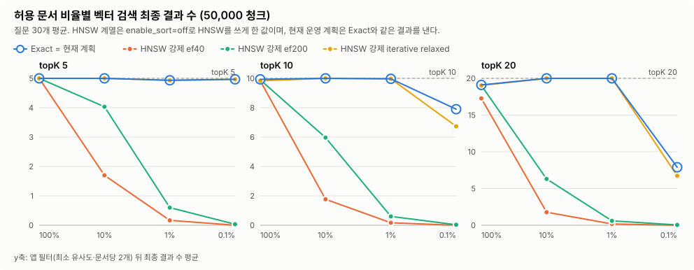

# Issue #545 권한 필터에 따른 벡터 검색 누락 재현과 인덱스 방식 비교 결과

- 측정일: 2026-10-17 (KST)
- 관련 이슈: #545
- 원시 데이터·재현 스크립트: [evidence/issue-545/](evidence/issue-545/)
- 코드 기준: `develop` `ed5d601`에서 측정했다. PR 기준 `develop` `39dbfb9`와 비교해 검색 Repository SQL·검색 서비스·검색 설정·`application*.yml`은 같다(바뀐 것은 live check 권한 조회 클래스뿐이며 측정 대상이 아니다).
- 범위: 로컬 pgvector 단계. 운영 코드·설정·마이그레이션은 바꾸지 않았다. DiskANN(pgvectorscale) 비교는 다음 단계다([7장](#7-다음-단계-diskannpgvectorscale-비교-절차)).

## 1. 결론

### 1.1 가설 판정

| 가설 | 현재 운영 SQL | HNSW를 실제로 쓰게 했을 때 | 판정 |
|---|---|---|---|
| **H1** 허용 문서 비율이 낮으면 HNSW 후보가 권한 필터에 걸려 결과가 topK보다 적거나 Recall이 떨어진다 | **재현 안 됨.** 실행 계획이 HNSW를 쓰지 않는다(720개 질문·조합 중 0회). 결과가 Exact와 모두 같다(Recall 1.00) | **강하게 재현됨.** 5만 청크·topK 10·허용 10%에서 SQL이 평균 2.6개만 돌려주고 최종 결과는 1.77개(30/30 질문이 topK 미달), Recall 0.18 | **조건부** (HNSW가 선택될 때만) |
| **H2** topK ≥ 11이면 요청 후보 수(topK×4)가 `ef_search` 40을 넘어, 권한 필터가 없어도 후보가 40개 안팎으로 묶인다 | **재현 안 됨.** topK 20에서 SQL이 요청한 80개를 모두 돌려준다 | **재현됨.** 허용 100%·topK 20에서 SQL이 30/30 질문 모두 정확히 40개만 돌려준다(SQL Recall 0.48). 최종 결과 미달 질문이 5개 → 15개로 는다 | **조건부** (HNSW가 선택될 때만) |

### 1.2 원인 분리 (DB 후보 부족 vs 앱 필터)

- **현재 운영 계획**에서 DB 후보 부족은 **0**이다. 모든 조합에서 Exact와 같은 후보를 돌려준다.
- 결과가 topK보다 적은 경우(예: 5만 청크·허용 0.1%·topK 10에서 7.90개)는 **권한 범위와 앱 필터** 때문이다. 허용 문서가 4건뿐이고 앱이 문서당 2개로 자르므로 최대 8개다. 이것은 의도한 동작이다.
- **HNSW를 쓰면** 부족분의 대부분이 DB 후보 부족에서 생긴다. 5만 청크·topK 10·허용 10% 기준, topK 10개 중 8.23개가 DB 단계에서 빠진다.

### 1.3 예상 밖으로 확인한 두 가지

1. **planner가 HNSW를 쓰지 않는 이유는 조인 행 수 오추정이다.** `documents`와의 조인 조건 두 개(`d.id = e.document_id`, `d.current_version_id = e.document_version_id`)를 서로 독립으로 보고 선택도를 곱한다. 그래서 조인 결과를 **9행으로 추정**하지만 실제로는 **50,008행**이다. 9행이면 정렬이 싸 보이므로 btree(`document_id`) → 해시 조인 → top-N 정렬, 즉 **사실상 Exact 검색**을 고른다.
2. **Prepared Statement가 Generic Plan으로 바뀌면 같은 SQL이 15~21배 느려진다.** 기본 `plan_cache_mode=auto`에서 같은 SQL을 **6번째 실행할 때부터** Generic Plan으로 바뀐다(psql로 확인: 1~5회 약 141ms → 6회째부터 약 2,100ms). Generic Plan에서는 `CAST(:queryVector AS vector)`가 상수로 접히지 않아, 1024차원 Vector 문자열을 **행마다 다시 파싱**한다. 서비스 경로 측정에서 5만 청크·허용 100%·topK 10의 벡터 검색 p50이 **204ms → 4,226ms**가 됐다. 권한과는 무관한 지연 원인이다.

### 1.4 권고안 (운영 변경 아님)

기능 동결(10/24)과 기능테스트(10/28)가 끝난 뒤 별도 [Fix]로 다시 측정하고 진행한다. 자세한 내용은 [5장](#5-권고안)에 있다.

1. **Generic Plan 지연부터 없앤다.** 질문 Vector를 스칼라 서브쿼리로 한 번만 계산하게 바꾸면 Generic Plan에서도 **2,129ms → 163ms**가 된다(psql 검증, Custom Plan은 142ms).
2. **지금 규모에서는 현재 계획(사실상 Exact)이 권한 필터에 안전하다.** HNSW를 쓰도록 바꾸려면 `hnsw.iterative_scan = relaxed_order`가 필수다. `ef_search`만 올려서는 허용 10%에서도 결과가 모자란다.
3. **허용 비율에 따라 유리한 방식이 다르다.** 허용 청크가 많으면 HNSW + iterative가 빠르고(5만 청크·100%: 16ms vs 204ms), 적으면 Exact가 빠르다(허용 1% 이하: 4~7ms vs 49~50ms).

## 2. 왜 이 시험을 했나

DocGrid 검색은 세 단계로 동작한다.

1. `VectorSearchRepository.findTopK`가 권한 조건(`e.document_id IN (:permittedIds)`)과 상태 조건을 건 채, 질문과 가까운 순서(`ORDER BY e.vector <=> :queryVector`)로 `topK × 4`개(최대 80개)를 가져온다.
2. 앱이 유사도 0.30 미만(하이브리드는 0.45 미만)을 버린다.
3. 한 문서에서 최대 2개만 남기고 topK개를 채운다.

pgvector HNSW는 기본 `ef_search = 40`이고 `iterative_scan`이 꺼져 있다. HNSW를 쓰면 Index가 먼저 가까운 후보를 40개 안팎 찾고, 권한 조건은 그 **뒤에** 거른다. 권한이 좁은 사용자는 볼 수 있는 문서에 답이 있어도 검색 결과에서 빠질 수 있다. 문서관리 시스템에서는 치명적인 문제라, 실제로 일어나는지와 원인을 실측으로 확인했다.

## 3. 시험 방법

### 3.1 환경

| 항목 | 값 |
|---|---|
| DB | PostgreSQL 17.8 (Debian 17.8-1.pgdg12+1), pgvector 0.8.1 |
| DB 실행 | 새로 띄운 격리 Docker 컨테이너. CI와 같은 이미지 digest(`pgvector/pgvector:0.8.1-pg17@sha256:3e8b…b21`). 기존 컨테이너·사용자 데이터는 쓰지 않음 |
| DB 설정 | 이미지 기본값: `shared_buffers` 128MB, `work_mem` 4MB, `maintenance_work_mem` 64MB, `jit` on, `plan_cache_mode` auto, `hnsw.ef_search` 40, `hnsw.iterative_scan` off, `hnsw.max_scan_tuples` 20,000 |
| HNSW Index | V32와 같은 정의 `USING hnsw (vector vector_cosine_ops)` (`m`·`ef_construction` 기본값 16·64) |
| Application | Java 17.0.18, PostgreSQL JDBC 42.7.11, `aarch64` (Docker Desktop 10 CPU·8GB) |
| Embedding | `BAAI/bge-m3` 1024차원, 로컬 Embedding 서버 |
| 공개 서비스·GCP | 사용 안 함 |

### 3.2 시험 데이터

**실제 데이터 (합성 0%)**

- 저장소 안의 팀 작성 문서 251건을 썼다: 예제 문서 15건(PDF·DOCX·HWPX) + `docs/design` Markdown 120건 + `docs/test-results` 최상위 Markdown 116건. `evidence/` 하위의 원시 로그는 제외했다.
- 운영과 같은 Parser·Chunker(1000자, overlap 200)·Embedding 입력 규칙(Section 경로 포함)·Batch 계획으로 처리했다. 결과는 **청크 3,572개**(문서당 평균 14.2개, 최소 1개, 최대 102개)다. 파싱 실패는 0건이었다.
- Embedding에는 4,118초가 걸렸다.

**5만 청크 데이터 (합성 92.9%)**

- 실제 데이터만으로는 수만 청크가 되지 않아 합성 문서를 더했다.
- 합성 문서 하나는 실제 문서 하나의 청크 본문·Section 정보를 그대로 복제한다.
- 각 청크 Vector는 원본과의 코사인 유사도가 정확히 `c`가 되도록, **다른 실제 문서 청크 Vector**에서 원본에 직교하는 성분만 섞어 만든다. 무작위 잡음 대신 실제 Embedding 방향을 쓰므로 분포가 실제에 가깝게 남는다.
- `c`는 문서마다 실제 청크의 "다른 문서 최근접 유사도" 분포의 P50~P90(0.759~0.835)에서 고른다. 합성 문서가 실제 말뭉치 안의 "그럴듯한 이웃" 정도로 비슷하고, 거의 같은 복제본이 되지 않게 하려는 것이다. 같은 분포의 P10은 0.688, 평균은 0.760이다.
- 결과: 문서 3,559건(실제 251 + 합성 3,308), 청크 50,008개. Seed 545로 고정해 재현할 수 있다.

**허용 문서**

문서를 Seed로 섞어 앞에서부터 비율만큼(최소 1건) 골랐다. 낮은 비율의 허용 문서는 높은 비율에 항상 포함된다. 권한은 질문 주제와 무관하게 무작위다.

| 규모 | 100% | 10% | 1% | 0.1% |
|---|---:|---:|---:|---:|
| 실제 3,572 청크 (문서/청크) | 251 / 3,572 | 25 / 301 | 3 / 34 | 1 / 10 |
| 5만 청크 (문서/청크) | 3,559 / 50,008 | 356 / 5,244 | 36 / 434 | 4 / 40 |

### 3.3 질문 세트

- **#456 질문 세트는 다시 쓰지 않았다.** #456의 말뭉치는 개인 학습 자료 5건(교육팀 PDF 포함)이라 저장소에 없고 저작권도 확인되지 않았다. 또한 주제(디렉토리 명령, STOMP, SOLID)가 이번 말뭉치와 달라, 유사도 기준(0.30)에서 대부분 걸러져 누락 측정을 흐린다.
- 대신 [`questions.json`](evidence/issue-545/questions.json)에 질문 30개를 측정 전에 고정했다. 예제 문서마다 1개(15개), 설계 문서 15건에서 1개씩(15개)이다.
- Recall은 Exact 결과를 정답으로 계산하므로 정답 청크 표시는 두지 않았다.
- 질문 Vector는 운영 첫 질문과 같은 경로(대화 문맥 없는 원문, 단건 Embedding API)로 만들었다.

### 3.4 측정 방식 8가지

| 방식 | 설정 | 의미 |
|---|---|---|
| `exact` | HNSW Index를 Transaction 안에서 지우고 Rollback | **Recall 정답** |
| `planner_default` | Index 있음, 기본 설정, Custom Plan | **현재 운영이 고르는 계획** |
| `planner_default_generic` | 위와 같고 `plan_cache_mode = force_generic_plan` | Prepared Statement가 재사용된 뒤의 현재 운영 |
| `hnsw_ef40`·`hnsw_ef100`·`hnsw_ef200` | `enable_sort = off`로 HNSW를 쓰게 하고 `ef_search` 변경 | HNSW가 선택됐을 때 |
| `iterative_relaxed`·`iterative_strict` | 위와 같고 `ef_search` 40 + `iterative_scan` | HNSW + 반복 스캔 |

- **처음 계획은 `ef_search`·`iterative_scan`만 바꾸는 것이었다.** 예비 실행에서 planner가 어떤 설정에서도 HNSW를 쓰지 않아 모든 방식의 결과가 같았다. 그래서 가설을 확인하려면 HNSW를 쓰게 할 장치가 필요했다.
- `enable_sort = off`는 정렬이 필요한 계획에 큰 비용을 붙여 HNSW 정렬 Index Scan을 고르게 한다. 운영 설정이 아니라 실험 장치다. 단어 갈래 조회에는 영향을 주지 않도록 `findTopK` 직전에만 켜고 직후에 되돌렸다.
- **`plan_cache_mode`는 모든 방식에서 명시했다.** 기본값 `auto`로 둔 예비 실행에서 같은 SQL을 반복할수록 지연이 수 초로 뛰어 실행 순서에 따라 결과가 달라졌다.

### 3.5 측정 항목

- **구조:** 운영 `VectorSearchQueryService`(벡터 단독)와 `HybridSearchQueryService`(하이브리드, 기본 경로)를 그대로 호출했다. 그 아래 `VectorSearchRepository`만 반환 행을 기록하는 Proxy로 감쌌다.
- **SQL 후보 수:** `findTopK`가 돌려준 행 수
- **최종 건수:** 서비스가 최소 유사도·문서당 2개 상한을 적용한 뒤 돌려준 개수
- **Recall:** `|측정 ∩ Exact| / |Exact|`(청크 ID 기준). SQL 단계와 최종 단계를 따로 계산하며, Exact 결과가 비면 계산하지 않는다.
- **지연:** 서비스 호출 한 번의 시간(JDBC·매핑 포함, 질문 Embedding 제외). 예열 1회 + 측정 3회의 nearest-rank p50·p95다(질문 30개 × 3회 = 표본 90개). Generic Plan 방식은 한 번이 수 초라 예열 0회·측정 1회다(표본 30개).
- **실행 계획:** 조합·질문마다 운영 `findTopK` SQL에 `EXPLAIN (ANALYZE, BUFFERS)`를 붙여 HNSW 사용 여부와 행 수를 남겼다. Custom Plan 방식은 EXPLAIN 결과 행 수와 서비스가 받은 SQL 행 수가 모든 행에서 같았다.
- **조합:** 2개 규모 × 허용 비율 4개 × topK 3개(5·10·20, 화면에서 고를 수 있는 값) × 방식 8개 × 질문 30개 = 5,760행이다. 반복 측정끼리 결과가 달라진 조합은 0개였다.

## 4. 결과

### 4.1 현재 운영 계획은 HNSW를 쓰지 않는다

`planner_default`와 `planner_default_generic`은 두 규모·모든 비율·모든 topK의 720개 질문·조합에서 HNSW를 한 번도 쓰지 않았다. 결과는 Exact와 모두 같았다(SQL·최종 Recall 1.00).

5만 청크·허용 100%·topK 10의 실행 계획 발췌다([plans-psql.txt](evidence/issue-545/plans-psql.txt)).

```text
Limit  (cost=2083.56..2083.59 rows=9) (actual rows=40)
  ->  Sort  Sort Key: ((e.vector <=> '<질문 벡터 1024차원>'))  Sort Method: top-N heapsort
        ->  Nested Loop  (cost=254.45..2083.42 rows=9) (actual rows=50008)
              ->  Hash Join  (rows=9) (actual rows=50008)
                    Hash Cond: ((e.document_id = d.id) AND (e.document_version_id = d.current_version_id))
                    ->  Index Scan using idx_embeddings_document_id on embeddings e  (actual rows=50008)
                    ->  Seq Scan on documents d  (actual rows=3559)
              ->  Index Scan using document_chunks_pkey on document_chunks dc
Execution Time: 338.816 ms
```

조인 추정 9행과 실제 50,008행의 차이가 HNSW를 고르지 않는 직접 원인이다. 추정은 규모가 커져도 "임베딩 수 ÷ 문서 수" 수준에 머문다. 따라서 이 쿼리 구조에서는 청크가 더 늘어도 planner가 HNSW로 바꿀 가능성이 낮다. 다만 이번에 측정하지 않은 규모에 대한 추정이다.

### 4.2 H2: 허용 100%에서도 HNSW `ef_search` 40은 40개에서 멈춘다


| 규모 | topK (SQL 요청) | Exact = 현재 계획 SQL 후보 | HNSW 강제 ef40 SQL 후보 (SQL Recall) | ef100 SQL 후보 | 최종 결과: Exact / ef40 (topK 미달 질문) |
|---|---|---:|---:|---:|---|
| 5만 청크 | 5 (20) | 20.0 | 20.0 (0.92) | 20.0 | 5.00 / 5.00 (0 / 0) |
| 5만 청크 | 10 (40) | 40.0 | 40.0 (0.92) | 40.0 | 9.93 / 9.83 (1 / 3) |
| 5만 청크 | **20 (80)** | **80.0** | **40.0 (0.48)** | 80.0 | **19.10 / 17.27 (5 / 15)** |
| 실제 3,572 | 5 (20) | 20.0 | 20.0 (0.85) | 20.0 | 4.93 / 4.93 (2 / 2) |
| 실제 3,572 | 10 (40) | 40.0 | 40.0 (0.86) | 40.0 | 10.00 / 10.00 (0 / 0) |
| 실제 3,572 | **20 (80)** | **80.0** | **40.0 (0.50)** | 80.0 | **20.00 / 18.57 (0 / 10)** |

- topK 20에서 ef40은 30개 질문 모두 정확히 40개를 돌려줬다(최소·최대 40).
- topK 5·10(요청 20·40)에서는 상한에 걸리지 않지만, HNSW 근사 탐색이라 SQL Recall이 0.85~0.92다. ef200이면 0.97~0.98이다.

### 4.3 H1: 허용 비율이 낮을수록 HNSW 결과가 사라진다



5만 청크·topK 10(SQL 요청 40)이다. 칸 값은 "SQL 후보 → 최종 결과 (최종 Recall)"이며, 모두 질문 30개 평균이다.

| 허용 비율 | Exact = 현재 계획 최종 | HNSW 강제 ef40 | HNSW 강제 ef200 | iterative relaxed | iterative strict |
|---|---:|---|---|---|---|
| 100% | 9.93 | 40.0 → 9.83 (0.91) | 40.0 → 9.90 (0.97) | 40.0 → 9.83 (0.91) | 40.0 → 9.83 (0.91) |
| 10% | 10.00 | **2.6 → 1.77 (0.18)** | 14.3 → 5.97 (0.57) | **40.0 → 10.00 (0.87)** | 40.0 → 10.00 (0.72) |
| 1% | 9.97 | **0.2 → 0.17 (0.02)** | 1.9 → 0.60 (0.06) | 40.0 → 9.97 (0.94) | 40.0 → 9.93 (0.76) |
| 0.1% | 7.90 | **0.0 → 0.00 (0.00)** | 0.0 → 0.03 (0.00) | 16.5 → 6.73 (0.68) | 15.8 → 6.73 (0.61) |

같은 조건의 실제 데이터(합성 0%)에서도 같은 경향이다.

| 허용 비율 | Exact = 현재 계획 최종 | HNSW 강제 ef40 | HNSW 강제 ef200 | iterative relaxed | iterative strict |
|---|---:|---|---|---|---|
| 100% | 10.00 | 40.0 → 10.00 (0.82) | 40.0 → 10.00 (0.96) | 40.0 → 10.00 (0.82) | 40.0 → 10.00 (0.82) |
| 10% | 10.00 | **4.4 → 2.47 (0.24)** | 17.8 → 8.57 (0.84) | 40.0 → 10.00 (0.94) | 40.0 → 10.00 (0.85) |
| 1% | 6.00 | 0.4 → 0.40 (0.07) | 1.4 → 0.97 (0.16) | 34.0 → 6.00 (1.00) | 33.8 → 5.97 (0.96) |
| 0.1% | 2.00 | 0.2 → 0.23 (0.12) | 0.5 → 0.47 (0.23) | 10.0 → 2.00 (1.00) | 9.9 → 2.00 (0.97) |

- **ef40의 SQL 후보 수는 대략 "40 × 허용 청크 비율"이다.** 5만 청크·10%에서 2.6개였다. `ef_search`를 200으로 올려도 10%에서 14.3개에 그쳐 topK 10을 채우지 못했다(23/30 질문 미달).
- **iterative relaxed는 10%·1%에서 개수를 모두 되찾는다.** 다만 Recall이 0.87~0.94라 일부 청크는 Exact와 다르다.
- **5만 청크·0.1%에서는 iterative도 16.5개만 돌려줬다.** 허용 청크 40개가 전체의 0.08%뿐이라, 반복 스캔 상한 `hnsw.max_scan_tuples`(20,000)을 다 써도 약 16개(20,000 × 40 / 50,008)만 만난다. 측정값 범위는 10~27개였다.
- **iterative strict는 relaxed보다 Recall이 낮았다**(5만 청크·10%: 0.72 vs 0.87). 이번에는 관측만 하고 원인은 분석하지 않았다.

### 4.4 원인 분리

벡터 단독 경로, topK 10이다. 단위는 질문당 평균 결과 수다.

| 규모 | 허용 비율 | topK − Exact<br>(권한 범위·앱 필터) | Exact − 현재 계획<br>(DB 후보 부족) | Exact − HNSW 강제 ef40<br>(DB 후보 부족) | Exact − iterative relaxed<br>(DB 후보 부족) |
|---|---|---:|---:|---:|---:|
| 5만 청크 | 100% | 0.07 | 0 | 0.10 | 0.10 |
| 5만 청크 | 10% | 0.00 | 0 | 8.23 | 0.00 |
| 5만 청크 | 1% | 0.03 | 0 | 9.80 | 0.00 |
| 5만 청크 | 0.1% | 2.10 | 0 | 7.90 | 1.17 |
| 실제 3,572 | 100% | 0.00 | 0 | 0.00 | 0.00 |
| 실제 3,572 | 10% | 0.00 | 0 | 7.53 | 0.00 |
| 실제 3,572 | 1% | 4.00 | 0 | 5.60 | 0.00 |
| 실제 3,572 | 0.1% | 8.00 | 0 | 1.77 | 0.00 |

- **"권한 범위·앱 필터" 부족은 문서당 2개 상한과 허용 문서 수에서 나온다.** 허용 문서가 1건(실제 0.1%)이면 최대 2개, 3건(실제 1%)이면 최대 6개, 4건(5만 청크 0.1%)이면 최대 8개다. 검색 결과가 한 문서에 몰리지 않게 하려는 의도된 동작이다.
- **현재 운영 계획의 DB 후보 부족은 모든 조합에서 0이다.**
- 개수가 같아도 Recall이 1보다 작으면 다른 청크가 섞였다는 뜻이다(예: iterative relaxed 5만 청크·10%, 10개 중 Recall 0.87).

### 4.5 하이브리드 경로 (기본 검색 경로)

5만 청크·topK 10의 최종 결과 수다.

| 허용 비율 | 하이브리드: Exact = 현재 계획 | 하이브리드: HNSW 강제 ef40 | 벡터 단독: HNSW 강제 ef40 |
|---|---:|---:|---:|
| 100% | 10.00 | 10.00 | 9.83 |
| 10% | 10.00 | 5.10 | 1.77 |
| 1% | 9.37 | 3.17 | 0.17 |
| 0.1% | 5.07 | 1.47 | 0.00 |

- **하이브리드도 같은 `findTopK`를 쓰므로, HNSW가 선택되면 같은 누락이 생긴다.** 단어 갈래 조회는 HNSW를 쓰지 않아 일부를 메운다(10%: 1.77 → 5.10).
- **하이브리드의 Exact 결과가 벡터 단독보다 적은 조건이 있다.** 예를 들어 실제 데이터·허용 10%·topK 10에서 하이브리드는 7.60개, 벡터 단독은 10.00개였다. 하이브리드가 벡터 유사도 기준을 0.45로 더 엄격하게 쓰기 때문이며, 앱 필터 쪽 원인이다.

### 4.6 지연

5만 청크·topK 10의 서비스 호출 지연이다. 단위는 ms, 표기는 p50 / p95다.

| 허용 비율 | Exact | 현재 계획 Custom | 현재 계획 Generic | HNSW 강제 ef40 | HNSW 강제 ef200 | iterative relaxed |
|---|---|---|---|---|---|---|
| 벡터 100% | 212.9 / 268.3 | 204.2 / 264.7 | **4,226.3 / 4,674.7** | 15.7 / 20.4 | 17.0 / 23.7 | 15.9 / 18.8 |
| 벡터 10% | 27.7 / 40.1 | 28.1 / 37.8 | **480.5 / 597.4** | 8.1 / 14.6 | 10.6 / 14.8 | 15.8 / 23.3 |
| 벡터 1% | 7.3 / 9.3 | 7.3 / 11.9 | 43.2 / 49.0 | 6.8 / 10.9 | 8.1 / 12.6 | 49.0 / 73.2 |
| 벡터 0.1% | 4.3 / 5.9 | 3.6 / 5.5 | 7.9 / 8.9 | 6.0 / 7.2 | 6.6 / 8.2 | 50.1 / 72.0 |
| 하이브리드 100% | 1,328.3 / 1,913.3 | 1,338.4 / 1,869.2 | **5,444.6 / 6,157.0** | 1,128.4 / 1,730.9 | 1,137.4 / 1,633.0 | 1,123.1 / 1,676.1 |
| 하이브리드 10% | 160.7 / 250.2 | 164.1 / 241.4 | 609.4 / 777.4 | 133.0 / 197.1 | 138.3 / 198.6 | 151.5 / 215.4 |

- **현재 계획(Custom)의 벡터 지연은 허용 청크 수에 비례해 늘어난다.** 50,008개를 모두 거리 계산하면 약 204ms다.
- **HNSW + iterative는 허용 청크가 많을 때 빠르고 적을 때 느리다.** 허용 100%에서는 Exact의 약 1/13이지만, 허용 1% 이하에서는 반복 스캔 때문에 Exact보다 약 7~14배 느렸다.
- **Generic Plan은 허용 청크가 많을수록 손해가 크다.** 100%에서 20.7배, 10%에서 17.1배였다. 실제 데이터·100%·topK 10에서도 17.8ms → 300.1ms로 16.9배였다.
- **하이브리드는 5만 청크·허용 100%에서 p50 1.3초다.** 벡터 방식과 거의 무관한 단어 갈래 비용이 대부분이다. #456은 83개 청크에서만 측정했으므로, 수만 청크에서의 단어 갈래 비용은 별도로 봐야 한다(이번 범위 밖).

### 4.7 Generic Plan 증빙 (psql)

5만 청크 데이터에서 운영 `findTopK` SQL을 그대로 `PREPARE`하고 시험과 같은 질문(D01)·허용 문서로 `EXPLAIN (ANALYZE, BUFFERS) EXECUTE`했다. 전문은 [plans-psql.txt](evidence/issue-545/plans-psql.txt)에 있다.

| 경우 | Execution Time |
|---|---:|
| 허용 100%·topK 10·Custom Plan (첫 실행, 디스크 읽기 포함) | 338.8 ms |
| 허용 100%·topK 10·Generic Plan | 2,129.4 ms |
| 허용 10%·topK 10·Custom Plan / Generic Plan | 16.7 ms / 219.8 ms |
| `auto` 모드에서 같은 Statement 반복 1~5회째 | 140.4~144.0 ms |
| `auto` 모드에서 같은 Statement 반복 **6~8회째** | **2,099.0~2,114.9 ms** |
| 권고안 검증: 질문 Vector를 `(SELECT CAST($1 AS vector))`로 바꾼 SQL, Custom / **Generic** | 142.5 ms / **162.8 ms** |
| 허용 100%·topK 20·HNSW 강제 ef40 / iterative relaxed | 결과 40행 / 80행 |
| 허용 10%·topK 10·HNSW 강제 ef40 / iterative relaxed | 결과 1행 / 40행 |

- **Generic Plan의 정렬 키는 `(e.vector <=> ($1)::vector)`다.** 계획 모양은 Custom Plan과 같지만, 행마다 `$1`을 Vector로 변환한다.
- **운영에서도 일어날 수 있다.** JDBC 드라이버 기본값(`prepareThreshold=5`)은 같은 SQL을 5번 넘게 실행하면 Server Prepared Statement를 쓴다. 이후 PostgreSQL은 6번째 실행부터 Generic Plan을 고를 수 있다. 허용 문서 수가 같은 사용자의 검색은 SQL 문자열(IN 목록의 자리표시자 수)이 같으므로, Connection Pool에서 반복되면 이 조건에 들어간다.
- **측정 경로에서도 관측했다.** `plan_cache_mode`를 명시하지 않은 예비 실행에서, 반복될수록 5만 청크·100%의 벡터 지연이 약 4.1초로 뛰었다.

### 4.8 Index 크기와 생성 시간

| 규모 | HNSW 생성 시간 | HNSW 크기 | `embeddings` 전체(TOAST·Index 포함) |
|---|---:|---:|---:|
| 실제 3,572 청크 | 0.93 s | 27.9 MiB | 48.2 MiB |
| 5만 청크 | 26.73 s | 390.7 MiB | 668.3 MiB |

`maintenance_work_mem` 64MB 기본값에서 측정했다. 현재 검색 SQL은 이 Index를 쓰지 않으므로, 지금은 저장 공간과 쓰기 비용만 들고 검색 이득은 없다.

### 4.9 전체 표와 원시 데이터

| 파일 | 내용 |
|---|---|
| [tables.md](evidence/issue-545/tables.md) | 규모 × topK별 모든 비율·방식 요약 표 |
| [summary.csv](evidence/issue-545/summary.csv) | 192개 조합 요약 |
| [rows.csv.gz](evidence/issue-545/rows.csv.gz) | 5,760개 측정 행. 반복 측정 지연 표본과 실행 계획 요약 포함 |
| [results.json.gz](evidence/issue-545/results.json.gz) | 하네스 원본 출력. 환경·설정·데이터 통계 포함 |
| [plans-psql.txt](evidence/issue-545/plans-psql.txt) | 4.7의 psql 실행 계획 전문(질문 Vector·허용 문서 ID 목록은 가림) |

## 5. 권고안

운영 코드·설정은 이번에 바꾸지 않았다. 아래는 기능테스트(10/28) 이후 별도 [Fix]에서 다시 측정한 뒤 적용할 후보다.

| 우선순위 | 권고 | 근거 | 확인할 것 |
|---|---|---|---|
| 1 | **질문 Vector를 한 번만 계산하도록 SQL을 바꾼다.** `CAST(:queryVector AS vector)` → `(SELECT CAST(:queryVector AS vector))`. 대안은 Vector 타입으로 Bind하거나, 이 쿼리만 Custom Plan을 강제(`prepareThreshold=0` 등)하는 것이다 | Generic Plan 2,129ms → 162.8ms(psql). 권한과 무관하게 지연을 15~21배 줄인다 | 서비스 경로 재측정. 세 Repository 쿼리에 같은 규칙을 적용할지 |
| 2 | **지금 규모에서는 현재 계획(사실상 Exact)을 유지한다** | 권한 필터로 결과를 잃지 않는다(DB 후보 부족 0) | 청크 수가 더 늘었을 때 허용 100% 지연 |
| 3 | **HNSW 경로를 도입한다면 `hnsw.iterative_scan = relaxed_order`를 필수로 둔다** | `ef_search` 200도 허용 10%에서 topK 10을 못 채움. iterative relaxed는 10%·1%에서 개수를 모두 회복 | relaxed는 거리 순서가 조금 어긋날 수 있음. 앱이 다시 정렬하지 않으므로 영향 확인 |
| 4 | **허용 비율에 따라 계획을 나눠야 한다.** 허용 청크가 적으면 Exact, 많으면 HNSW + iterative | 허용 1% 이하에서 Exact 4~7ms vs iterative 49~50ms. 0.1%에서는 `max_scan_tuples` 상한으로 iterative도 일부만 찾음 | 조인 오추정(9행) 때문에 planner가 스스로 나누지 못함. 쿼리 구조 변경이 필요 |
| 5 | **안전장치로 `hnsw.iterative_scan = relaxed_order`를 기본값으로 둘지 검토한다** | HNSW가 선택되지 않으면 영향이 없고, 선택되는 순간의 누락을 막는다 | 3과 같은 순서 문제 |

## 6. 한계

- **5만 청크 데이터의 92.9%가 합성이다.** 합성 방법이 실제 Embedding 분포를 완전히 재현한다고 보장하지 않는다. 대신 합성 0%인 실제 데이터(3,572 청크)에서도 H1·H2와 원인 분리 결론이 같은지 함께 확인했다.
- **권한은 질문 주제와 무관하게 무작위로 골랐다.** 부서·컬렉션처럼 주제와 상관된 권한에서는 숫자가 달라질 수 있다.
- **`enable_sort = off`는 실험 장치다.** 쿼리를 바꿔 HNSW를 쓰게 했을 때의 실제 계획과 다를 수 있다.
- **한 대의 로컬 장비, PostgreSQL 기본 설정, 질문 30개만 썼다.** OpenSQL 서버 성능이나 운영 SLO가 아니다.
- **지연은 서비스 메서드 호출 기준이다.** HTTP·인증·질문 Embedding·live check·결과 저장은 포함하지 않았다.
- **조합별 EXPLAIN은 Custom Plan이다.** Generic Plan의 실행 계획은 4.7의 psql 증빙으로만 확인했다.
- **iterative strict가 relaxed보다 Recall이 낮은 원인은 분석하지 않았다.**

## 7. 다음 단계: DiskANN(pgvectorscale) 비교 절차

이번에는 실행하지 않았다. 다음 단계에서 OpenSQL VM으로 같은 시험을 돌릴 때의 절차다.

### 0단계: 확장 확인

#124 단일 모드 OpenSQL 환경에는 pgvectorscale 0.9.0이 포함돼 있었지만, 실제로 만든 확장은 `vector`뿐이었다. 2026-09-23 GCP 3노드 VM에는 선택 항목인 pgvectorscale을 설치하지 않았다([gimin-opensql-three-node-runtime-activation-20260923.md](gimin-opensql-three-node-runtime-activation-20260923.md)). 따라서 먼저 다음을 확인한다.

```sql
SELECT name, default_version, installed_version
FROM pg_available_extensions WHERE name IN ('vector', 'vectorscale');
-- 목록에 없으면 OpenSQL 배포본의 pgvectorscale 패키지를 시험 노드에 설치한 뒤 다시 확인한다.
CREATE EXTENSION IF NOT EXISTS vectorscale CASCADE;   -- 격리 시험 DB에서만
SELECT extversion FROM pg_extension WHERE extname = 'vectorscale';
```

### 1~3단계: 같은 시험 반복

1. **데이터 적재:** 이번 하네스로 같은 Seed의 데이터를 격리 스키마에 적재한다. Index를 한 번에 하나만 두고 `CREATE INDEX … USING diskann (vector vector_cosine_ops)`(StreamingDiskANN)로 만든 뒤 생성 시간·크기를 기록한다.
2. **방식 추가:** `PermissionRecallBenchmark.Method`에 DiskANN 방식을 더한다(시험 코드 변경). `enable_sort = off`로 DiskANN을 쓰게 하고 `diskann.query_search_list_size`(기본 100)와 `diskann.query_rescore`(기본 50)를 바꾼다. StreamingDiskANN은 필터를 통과하는 행이 LIMIT을 채울 때까지 계속 스트리밍하므로, HNSW iterative relaxed가 주 비교 대상이다.
3. **측정:** 같은 비율 × topK × 질문으로 Exact 기준 Recall·지연·실행 계획을 잰다. 허용 0.1%처럼 iterative가 상한에 걸린 구간이 핵심이다.

**범위 밖으로 두는 것**
- pgvectorscale의 라벨 기반 필터는 권한을 Index에 복제한다. 권한 회수 직후 갱신이 늦어지는 문제가 있어 이번 비교에서 뺀다.
- 채택은 대회 후에 한다. README 빠른 실행과 CI가 쓰는 `pgvector/pgvector` 이미지에 vectorscale이 없기 때문이다.

## 8. 재현 방법

격리 DB를 새로 띄우고 접속 정보를 환경변수로 넘긴다. 지정하지 않으면 시험 기본 접속 정보로 다른 DB에 스키마를 만들 수 있다.

```bash
docker run -d --name docgrid-bench545-pg -e POSTGRES_DB=bench545 -e POSTGRES_USER=bench545 \
  -e POSTGRES_PASSWORD=<로컬 비밀번호> -p 127.0.0.1:55471:5432 \
  -v "$PWD/docker/postgres/init/001-enable-vector.sql:/docker-entrypoint-initdb.d/001-enable-vector.sql:ro" \
  pgvector/pgvector:0.8.1-pg17@sha256:3e8b3adfd27b5707128f60956f62a793c3c9326ea8cfaf0eab7adccb5d700b21

export DB_HOST=127.0.0.1 DB_PORT=55471 DB_NAME=bench545 DB_USER=bench545 DB_PASSWORD=<로컬 비밀번호> DB_SSLMODE=disable

# 1) 실제 문서·질문 Embedding 캐시 (Embedding 서버 BGE-M3 필요, 약 70분)
./backend/gradlew -p backend vectorSearchPerformanceTest --tests '*PermissionRecallBenchmark' \
  -Dvector.search.performance.permission.phase=prepare

# 2) 측정 (약 95분). 결과: backend/build/reports/permission-recall/results.json, plans.json
./backend/gradlew -p backend vectorSearchPerformanceTest --tests '*PermissionRecallBenchmark' \
  -Dvector.search.performance.permission.phase=measure -Dvector.search.performance.permission.drop-schema=false

# 3) 표·그래프·CSV
python3 docs/test-results/evidence/issue-545/make_report.py backend/build/reports/permission-recall/results.json docs/test-results/evidence/issue-545

# 4) psql 실행 계획 증빙 (2를 drop-schema=false로 실행해 5만 청크가 남아 있을 때)
python3 docs/test-results/evidence/issue-545/explain_plans.py backend backend/build/reports/permission-recall/plans.json > plans.sql
docker exec -i docgrid-bench545-pg psql -U bench545 -d bench545 -q < plans.sql > plans-raw.txt
python3 docs/test-results/evidence/issue-545/explain_plans.py --mask plans-raw.txt > docs/test-results/evidence/issue-545/plans-psql.txt
```

- 시험은 `vector.search.performance.permission.phase` 시스템 속성이 있을 때만 실행되므로, 기존 `vectorSearchPerformanceTest`(#131)와 일반 `test`에는 영향이 없다.
- 규모·비율·topK·방식·질문 수는 `scales`·`ratios`·`top-ks`·`methods`·`question-limit` 속성으로 바꿀 수 있다.

시험 코드는 `backend/src/test/java/com/opensource/docgrid/domain/search/benchmark/`의 다음 클래스다.

| 클래스 | 역할 |
|---|---|
| `PermissionRecallBenchmark` | 적재·방식 전환·측정·보고서 |
| `PermissionRecallCorpus` | 실제 문서를 운영 처리 경로로 Embedding하고 캐시 |
| `PermissionRecallDataset` | 결정적 합성 확장·허용 문서 선택 |
| `PermissionRecallMetrics` | Recall·백분위 |
| `PermissionRecallDatasetTest` | 위 계산의 단위 테스트 |

## 9. 자동 테스트 결과

### 9.1 시험 하네스 단위 테스트

```text
./backend/gradlew -p backend test --tests '*PermissionRecallDatasetTest'
PermissionRecallDatasetTest: tests=7, skipped=0, failures=0, errors=0
```

확인하는 것은 다음과 같다.
- 정상 케이스: 합성 Vector가 단위 길이이고 원본과의 유사도가 지정값과 같다. 같은 Seed면 같은 결과를 만든다. 허용 문서가 중첩되고 최소 1건이다. Recall·백분위가 정확하다.
- 경계·예외 케이스: 섞을 Vector가 원본과 같은 방향이면 무작위 직교 방향으로 대신한다. 목표가 실제 청크 수 이하면 실제 문서만 쓴다. 정답 집합이 비면 Recall을 계산하지 않는다.

### 9.2 전체 테스트

격리 DB(위 컨테이너, 시험 스키마는 `docgrid_test` 등 별도)와 격리 Valkey 컨테이너에 연결해 CI와 같은 설정으로 실행했다. 설정은 `SPRING_DATASOURCE_HIKARI_MAXIMUM_POOL_SIZE=3`, CI 전용 `JWT_SECRET`이다.

```text
./backend/gradlew -p backend test      # PR 기준 develop 39dbfb9 + 이번 변경
BUILD SUCCESSFUL in 1m 24s
테스트 클래스 252개, tests=1,508, skipped=5, failures=0, errors=0
```

측정 기준 `ed5d601`에서 실행한 결과도 같았다(1,508개, 실패 0, 건너뜀 5).

이번 변경은 시험 코드 5개 파일과 문서만 추가했다. 운영 코드·설정·마이그레이션 변경은 없다.
