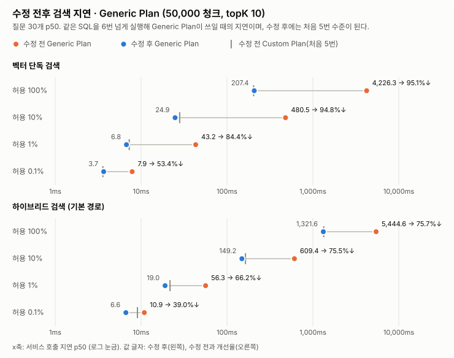
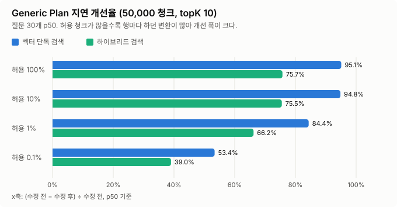
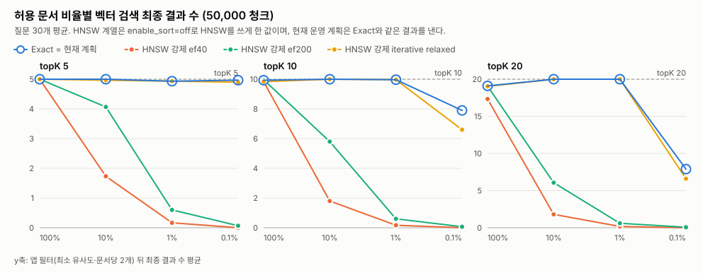
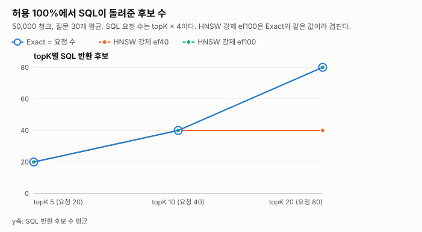

# Issue #549 Generic Plan 질문 Vector 변환 수정 전후 성능 비교

- 측정일: 2026-10-17 (KST)
- 관련 이슈: #549
- 설계 문서: [gimin-#549-generic-plan-query-vector-cast.md](../design/gimin-%23549-generic-plan-query-vector-cast.md)
- 기준(수정 전) 측정: [#545 결과](gimin-%23545-permission-filter-vector-recall.md)
- 원시 데이터·재현 스크립트: [evidence/issue-549/](evidence/issue-549/)

## 1. 결론

벡터 검색 SQL에서 질문 Vector 변환을 `CAST(:queryVector AS vector)` → `(SELECT CAST(:queryVector AS vector))`로 바꿨다. **같은 SQL을 6번 넘게 실행해 Generic Plan이 쓰일 때의 지연이 처음 5번(Custom Plan) 수준으로 내려왔다.** 검색 결과는 바뀌지 않았다.

5만 청크·topK 10, 질문 30개 p50이다. 수정 전 값은 #545 기준 측정이다.

| 허용 비율 | 벡터 단독 검색: 수정 전 → 수정 후 | 개선율 | 하이브리드 검색(기본 경로): 수정 전 → 수정 후 | 개선율 |
|---:|---|---:|---|---:|
| 100% | 4,226.3 → **207.4ms** | **95.1%** (20.4배) | 5,444.6 → **1,321.6ms** | **75.7%** |
| 10% | 480.5 → **24.9ms** | **94.8%** | 609.4 → **149.2ms** | **75.5%** |
| 1% | 43.2 → **6.8ms** | **84.4%** | 56.3 → **19.0ms** | **66.2%** |
| 0.1% | 7.9 → **3.7ms** | **53.4%** | 10.9 → **6.6ms** | **39.0%** |





- **Generic Plan 개선율 (벡터 단독 p50, 24개 조합):** 5만 청크는 중앙값 91.4%(27.2~95.2%), 실제 3,572 청크는 중앙값 80.2%(17.3~95.0%)다. 허용 청크가 많을수록 행마다 하던 변환이 많아 개선 폭이 크다.
- **수정 후 Generic Plan은 Custom Plan과 같은 속도다.** 5만 청크·100%·topK 10에서 Generic 207.4ms, Custom 208.9ms다.
- **psql 반복 실행:** 수정 전에는 같은 Statement를 6회째 실행할 때부터 145ms → 2,216ms로 뛰었다. 수정 후에는 1~8회 내내 142~163ms다.
- **검색 결과는 같다.** Exact·현재 계획(Custom·Generic) 2,160개 질문·조합에서 SQL 후보·최종 결과·Recall이 수정 전과 모두 같았다.
  - HNSW 강제 방식에서 보인 차이는 측정마다 HNSW Index를 새로 만들기 때문이다. **같은 Index 위에서는 수정 전/후 결과가 120/120 같았다.**
- **Custom Plan과 HNSW 강제 계획은 사실상 변화가 없다.** 같은 Index에서 번갈아 15회 잰 실행 시간 변화가 -1.2~+2.0%(HNSW 계획은 +0.1ms)다.
- **하이브리드는 개선 후에도 5만 청크·100%에서 p50 1.3초다.** 남은 시간은 단어 갈래 조회 비용이며, 이 수정의 범위 밖이다(#545 4.6).

## 2. 무엇을 바꿨나

`VectorSearchRepository`의 SQL 세 곳이다. `findTopK`의 SELECT 거리 계산과 ORDER BY, 그리고 `findLexicalCandidates`의 거리 계산이다. 스칼라 서브쿼리는 PostgreSQL이 InitPlan으로 실행마다 한 번만 계산한다. 원인과 다른 방법을 고르지 않은 이유는 [설계 문서](../design/gimin-%23549-generic-plan-query-vector-cast.md)에 있다.

## 3. 측정 환경과 방법

### 3.1 #545와 같은 환경

| 항목 | 값 |
|---|---|
| DB | 새 격리 컨테이너 `pgvector/pgvector:0.8.1-pg17@sha256:3e8b…b21`(CI·#545와 같은 digest). PostgreSQL 17.8, pgvector 0.8.1 |
| DB 설정 | 이미지 기본값(`shared_buffers` 128MB, `work_mem` 4MB, `maintenance_work_mem` 64MB, `jit` on, `plan_cache_mode` auto). #545와 같음 |
| 데이터 | #545와 같은 원본 251건(`develop` `ed5d601`의 문서를 따로 풀어 지정)과 같은 BGE-M3 Embedding 캐시, Seed 545. 5만 청크 HNSW Index 크기가 409,673,728바이트로 #545와 바이트까지 같다 |
| 하네스·질문 | #545(PR #547)의 `PermissionRecallBenchmark`, 질문 30개, 예열 1회·측정 3회(Generic Plan은 0회·1회) |
| Application | Java 17.0.18, PostgreSQL JDBC 42.7.11, `aarch64` |

### 3.2 측정 세 가지

| 측정 | 내용 | 시각 |
|---|---|---|
| **A/B** | 5만 청크·topK 10·허용 4단계 × Exact·현재 계획(Custom·Generic)을 수정 전 코드와 수정 후 코드로 **연달아** 측정. 시간대에 따른 흔들림을 줄이려는 것이다 | 22:18~22:45 |
| **전체 재측정** | 수정 후 코드로 #545와 같은 192개 조합(2개 규모 × 허용 4단계 × topK 3개 × 방식 8개 × 질문 30개)을 다시 측정해 #545 기준과 비교 | 22:45~00:04 |
| **psql** | ① 같은 Prepared Statement를 `auto` 모드로 8회 반복 ② 같은 HNSW Index 위에서 수정 전/후 SQL의 결과·실행 시간 비교 | 00:06 이후 |

개선율은 `(수정 전 − 수정 후) ÷ 수정 전 × 100`이다. 양수면 빨라진 것이다.

## 4. 결과

### 4.1 A/B (수정 전·후 연달아 측정)

5만 청크·topK 10, 질문 30개다. 표기는 p50 / p95, 단위는 ms다. 전체 표는 [ab-comparison.md](evidence/issue-549/ab-comparison.md)에 있다.

| 허용 비율 | 방식 | 벡터: 수정 전 → 수정 후 | 개선율 (p50) | 하이브리드 p50: 수정 전 → 수정 후 | 개선율 | 결과 다른 질문 |
|---:|---|---|---:|---|---:|---:|
| 100% | 현재 계획 Generic | 4,465.7 / 5,178.2 → **218.5 / 255.9** | **95.1%** | 5,799.9 → 1,380.6 | 76.2% | 0/30 |
| 100% | 현재 계획 Custom | 234.2 / 376.1 → 231.0 / 341.3 | 1.3% | 1,403.7 → 1,379.8 | 1.7% | 0/30 |
| 10% | 현재 계획 Generic | 461.1 / 545.5 → **27.3 / 28.6** | **94.1%** | 596.4 → 152.8 | 74.4% | 0/30 |
| 10% | 현재 계획 Custom | 27.2 / 29.6 → 29.2 / 38.3 | -7.6% | 152.1 → 158.7 | -4.4% | 0/30 |
| 1% | 현재 계획 Generic | 44.6 / 46.8 → **7.3 / 9.1** | **83.7%** | 58.0 → 20.1 | 65.3% | 0/30 |
| 1% | 현재 계획 Custom | 6.8 / 8.5 → 6.7 / 9.6 | 1.4% | 19.4 → 20.4 | -5.5% | 0/30 |
| 0.1% | 현재 계획 Generic | 7.8 / 9.0 → **2.6 / 3.8** | **66.5%** | 11.6 → 5.5 | 53.1% | 0/30 |
| 0.1% | 현재 계획 Custom | 2.8 / 4.2 → 3.2 / 5.7 | -13.6% | 7.1 → 7.8 | -9.5% | 0/30 |

전체 재측정(#545 기준 대비)과 A/B의 Generic Plan 개선율 차이는 0~13%p였다(가장 큰 차이는 0.1%: 53.4% vs 66.5%). 원래 빨랐던 Custom Plan의 2ms 이내(-13.6~+1.4%) 차이는 측정 흔들림이다. 아래 4.4에서 같은 Index로 다시 잰 결과가 근거다.

### 4.2 전체 192개 조합 (#545 기준 대비)

현재 계획(운영 경로)의 벡터 단독 p50이다. 단위는 ms이며 모든 조합은 [full-comparison.md](evidence/issue-549/full-comparison.md)·[full-comparison.csv](evidence/issue-549/full-comparison.csv)에 있다.

| 규모 | 허용 비율 | Generic: 수정 전 → 수정 후 (topK 10) | 개선율 | Custom: 수정 전 → 수정 후 (topK 10) | 수정 후 Generic ÷ Custom |
|---|---:|---|---:|---|---:|
| 5만 청크 | 100% | 4,226.3 → 207.4 | **95.1%** | 204.2 → 208.9 | 0.99 |
| 5만 청크 | 10% | 480.5 → 24.9 | **94.8%** | 28.1 → 26.7 | 0.93 |
| 5만 청크 | 1% | 43.2 → 6.8 | **84.4%** | 7.3 → 7.4 | 0.91 |
| 5만 청크 | 0.1% | 7.9 → 3.7 | **53.4%** | 3.6 → 3.1 | 1.19 |
| 실제 3,572 | 100% | 300.1 → 17.8 | **94.1%** | 17.8 → 18.0 | 0.99 |
| 실제 3,572 | 10% | 31.8 → 5.6 | **82.4%** | 5.6 → 5.5 | 1.03 |
| 실제 3,572 | 1% | 7.1 → 2.6 | **62.9%** | 3.4 → 2.7 | 0.99 |
| 실제 3,572 | 0.1% | 4.2 → 1.7 | **58.5%** | 1.8 → 2.3 | 0.75 |

| 방식 | 벡터 단독 p50 개선율 중앙값 (24개 조합) | 결과 다른 질문 |
|---|---:|---:|
| 현재 계획 Generic | 5만 청크 91.4% · 실제 80.2% | 0/720 |
| 현재 계획 Custom | 5만 청크 1.7% · 실제 -1.6% | 0/720 |
| Exact | 5만 청크 -2.4% · 실제 -6.9% | 0/720 |
| HNSW 강제(ef40·100·200, iterative 2종) | -14.2~-1.0% (차이 -0.9~-0.1ms) | 64~292/720 (Index 재생성 영향, 4.4) |

- **Generic Plan 이외의 방식은 1ms 미만 차이다.** 전체 재측정은 #545 기준보다 약 6시간 늦게 실행했다. 그래서 수정과 무관한 Exact도 0.2~0.3ms 느리게 나왔다. 같은 Index·같은 시각에 번갈아 잰 4.4 결과로 판단했다.
- **수정 후에도 HNSW 사용 여부는 같았다.** 현재 계획은 720개 질문·조합 모두 HNSW를 쓰지 않고, HNSW 강제 방식은 모두 쓴다.

### 4.3 psql: 같은 Statement 반복 실행

5만 청크·허용 100%·topK 10, 질문 D01이다. `EXPLAIN (ANALYZE) EXECUTE`의 Execution Time이며, 전문은 [generic-plan-psql.txt](evidence/issue-549/generic-plan-psql.txt)에 있다.

| 실행 | 수정 전 | 수정 후 |
|---|---:|---:|
| `auto` 모드 1~5회째 | 145.3~152.2ms | 142.1~163.1ms |
| `auto` 모드 **6~8회째** | **2,216.0~2,346.2ms** | **142.2~148.5ms** |
| `force_custom_plan` | 356.4ms (첫 실행, 디스크 읽기 포함) | 147.1ms |
| `force_generic_plan` | 2,293.3ms | **149.6ms** |
| 허용 10% `force_generic_plan` | 231.2ms | **13.6ms** |

수정 후 Generic Plan의 정렬 키는 `(InitPlan 1).col1`을 참조한다. 수정 전처럼 `($1)::vector`를 행마다 계산하지 않는다.

### 4.4 같은 HNSW Index 위에서 수정 전/후 SQL 비교

전체 재측정은 실행마다 HNSW Index를 새로 만든다. 그래서 HNSW 강제 방식의 결과 차이가 SQL 수정 때문인지 Index 재생성 때문인지 구분할 수 없었다. 한 Index 위에서 두 SQL을 비교했다([same-index-check.md](evidence/issue-549/same-index-check.md)).

| 비교 | 결과 |
|---|---|
| HNSW 강제 ef40·iterative relaxed × 허용 100%·10% × 질문 30개의 청크 ID 순서 | **120/120 같음** |
| 현재 계획 Custom 허용 100% / 10% / 0.1% (번갈아 15회 중앙값) | 141.40 → 139.64ms (-1.2%) / 12.55 → 12.65ms (+0.8%) / 0.375 → 0.376ms (+0.3%) |
| HNSW 강제 ef40 허용 100% / iterative relaxed 허용 10% | 5.21 → 5.31ms (+2.0%) / 8.14 → 8.26ms (+1.5%) |

따라서 다음과 같이 판단한다.
- HNSW 강제 방식의 결과 차이는 HNSW Index 재생성에서 온다. 같은 Index에서는 수정 전/후 결과가 같다.
- 스칼라 서브쿼리 자체의 비용은 HNSW 계획에서 약 0.1ms이고, Custom Plan에서는 측정되지 않을 만큼 작다.

### 4.5 수정 후 결과 (#545와 같은 형식)

수정 후에도 권한 필터 결과는 #545와 같다. 현재 계획은 HNSW를 쓰지 않아 결과가 빠지지 않고, HNSW를 강제하면 허용 비율이 낮을수록 결과가 빠진다.





전체 표는 [after-fix/tables.md](evidence/issue-549/after-fix/tables.md)에 있다. 원시 데이터는 [after-fix/results.json.gz](evidence/issue-549/after-fix/results.json.gz), [rows.csv.gz](evidence/issue-549/after-fix/rows.csv.gz), [summary.csv](evidence/issue-549/after-fix/summary.csv)다.

## 5. 자동 테스트 결과

### 5.1 회귀 통합 테스트

`VectorSearchRepositoryGenericPlanIntegrationTest`에 운영 `@Query` SQL을 그대로 읽어 검사하는 테스트 3건을 추가했다.

| 테스트 | 수정 전 SQL | 수정 후 SQL |
|---|---|---|
| Generic Plan 결과가 Custom Plan과 같은 청크·거리 순서 | 통과 | 통과 |
| Generic Plan 정렬 키가 `$1`을 직접 쓰지 않고 InitPlan 결과를 씀 | **실패** (`((e.vector <=> ($1)::vector))`) | 통과 |
| `enable_sort=off`일 때 HNSW 정렬 Index Scan을 쓰고 정렬 키에 `$1`이 없음 | **실패** (`(e.vector <=> ($1)::vector)`) | 통과 |

같은 SQL 파일의 단어 갈래 쿼리 테스트(`LexicalSearchRepositoryIntegrationTest`) 12건도 수정 후 모두 통과했다.

### 5.2 전체 테스트

격리 DB와 격리 Valkey 컨테이너, CI와 같은 설정(`SPRING_DATASOURCE_HIKARI_MAXIMUM_POOL_SIZE=3`, CI 전용 `JWT_SECRET`)으로 실행했다.

```text
./backend/gradlew -p backend test      # develop a24d3e8(PR #547 포함) + 이번 수정
BUILD SUCCESSFUL in 1m 26s
테스트 클래스 253개, tests=1,511, skipped=5, failures=0, errors=0
```

## 6. 한계

- **Generic Plan 측정은 `plan_cache_mode = force_generic_plan`으로 강제한 값이다.** 기본 `auto`에서 실제로 6회째부터 바뀌는 것은 psql 반복 실행으로 확인했다. 앱의 Connection Pool에서 언제 바뀌는지는 Connection별 실행 횟수에 따라 다르다.
- **수 ms 이하 조합의 개선율은 흔들림이 크다.** 예를 들어 실제 3,572 청크·허용 0.1%의 Custom Plan은 1.8 → 2.3ms였다. 결론은 100%·10% 조합과 같은 Index 비교를 근거로 한다.
- **한 대의 로컬 장비, PostgreSQL 기본 설정이다.** #545와 같은 한계를 가진다(합성 92.9%, 무작위 권한, 질문 30개).
- **하이브리드 검색의 단어 갈래 비용은 그대로다.** 5만 청크·100%에서 p50 1.3초가 남는다.

## 7. 재현 방법

#545 [재현 방법](gimin-%23545-permission-filter-vector-recall.md#8-재현-방법)으로 격리 DB와 Embedding 캐시를 준비한다. 원본은 #545와 같은 `ed5d601`의 문서를 따로 풀어 지정한다. 지금 저장소의 `docs/`가 달라졌기 때문이다.

```bash
git archive ed5d601 -- docs/design docs/test-results examples/demo-corpus | tar -x -C <corpus-root>

./backend/gradlew -p backend vectorSearchPerformanceTest --tests '*PermissionRecallBenchmark' \
  -Dvector.search.performance.permission.phase=measure -Dvector.search.performance.permission.drop-schema=false \
  -Dvector.search.performance.permission.repository-root=<corpus-root> \
  -Dvector.search.performance.permission.output=build/reports/permission-recall/after-full-results.json \
  -Dvector.search.performance.permission.plan-output=build/reports/permission-recall/after-full-plans.json

# 수정 후 표·그래프 (#545 스크립트)
python3 docs/test-results/evidence/issue-545/make_report.py backend/build/reports/permission-recall/after-full-results.json docs/test-results/evidence/issue-549/after-fix

# 수정 전(#545 기준) 대비 비교 표·그래프
python3 docs/test-results/evidence/issue-549/compare_results.py docs/test-results/evidence/issue-545/results.json.gz \
  docs/test-results/evidence/issue-549/after-fix/results.json.gz docs/test-results/evidence/issue-549 full-

# psql 증빙 (5만 청크가 남아 있을 때)
python3 docs/test-results/evidence/issue-549/explain_generic_plan.py backend backend/build/reports/permission-recall/after-full-plans.json > generic.sql
python3 docs/test-results/evidence/issue-549/same_index_check.py build backend backend/build/reports/permission-recall/after-full-plans.json > check.sql
```

A/B는 같은 명령에 `-Dvector.search.performance.permission.scales=50000 -Dvector.search.performance.permission.top-ks=10 -Dvector.search.performance.permission.methods=exact,planner_default,planner_default_generic`를 붙여 수정 전 코드와 수정 후 코드에서 한 번씩 실행했다.
